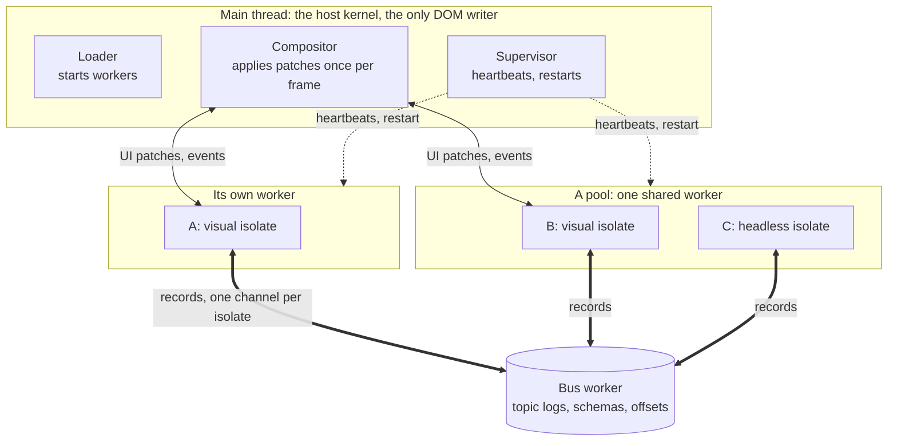

<p align="center">
  <picture>
    <source media="(prefers-color-scheme: dark)" srcset="https://isoloop.dev/brand/expressive-dark.svg">
    
  </picture>
</p>

<h1 align="center">Isoloop</h1>

<h3 align="center">Event-loop isolation for JavaScript apps</h3>

<p align="center">
  <a href="https://www.npmjs.com/package/@isoloop/runtime"></a>
  <a href="https://github.com/isoloop/isoloop/actions/workflows/ci.yml"></a>
  <a href="LICENSE"></a>
  
  
</p>

<p align="center">
  <a href="https://isoloop.dev">Website</a> •
  <a href="https://isoloop.dev/features/">Features</a> •
  <a href="https://isoloop.dev/examples/">Examples</a> •
  <a href="https://isoloop.dev/docs/">Guide</a> •
  <a href="docs/adr/README.md">ADRs</a>
</p>

Isoloop is an open-source TypeScript library. Each part of your app (a React or Preact UI tree, plain DOM, or a headless task) runs as an *isolate*, on its own worker or in a shared pool. Isolates talk only through a message bus with typed topics, retention and replay. When one blocks or crashes, the rest of the app keeps running; the supervisor restarts it, and it rebuilds its state from the bus.

**0.1 is the first release.** The parts marked experimental may change in any minor, and only the latest release is supported ([Limits](https://isoloop.dev/docs/limits/)). What's done and what's next: [Roadmap](#roadmap).

See it run: the [basic example](https://isoloop.dev/examples/basic/), four isolates on three event loops, live.

## Why

In most apps, all the code shares one main thread, one heap and one event loop: every widget, every micro-frontend, and every headless engine such as a state store, a sync engine or a search index. One slow or broken part makes the whole app janky or blank. Sandboxes isolate globals and styles, not CPU time or crashes. A plain worker isolates CPU time, but leaves you to wire up how independent parts share data, and what happens when one of them fails.

Isoloop is built on one principle: **code that shares data shouldn't have to share an event loop.** Parts run apart, and the only thing they share is a log of typed messages.

Where it fits and what it gives: [Features](https://isoloop.dev/features/).

## Getting started

A minimal app needs the host, the runtime and the bus, a [Standard Schema](https://standardschema.dev) library for the topic schemas (Zod here), and, with Vite, the plugin:

```sh
npm install @isoloop/host @isoloop/runtime @isoloop/bus zod
npm install -D @isoloop/vite
```

For a React or Preact isolate, add `@isoloop/react` or `@isoloop/preact`. pnpm and yarn work the same way (`pnpm add`, `yarn add`).

**1. The contracts:** one module of topics, shared by the host, the isolates and the bus worker, which validates every record against it.

```ts
// contracts.ts
import { contracts, topic } from '@isoloop/bus';
import { z } from 'zod';

export const cartItems = topic('cart.items.v1', {
  schema: z.object({ sku: z.string(), qty: z.number().int().positive() }),
  retention: { kind: 'compacted' },
});

export default contracts(cartItems);
```

**2. The host:** the kernel on the main thread starts the bus and the isolates, and supervises them.

```ts
// main.ts, with isoloop() from '@isoloop/vite' in vite.config.ts
import { createKernel } from '@isoloop/host';
import workers from 'virtual:isoloop/workers';
import list from './contracts';
import contractsUrl from './contracts?isolate';
import cart from './cart?isolate';

const kernel = createKernel({
  contracts: { url: contractsUrl, list },
  workers,
  supervisor: { strategy: 'one-for-one', maxRestarts: 3, withinMs: 60_000 },
});

kernel.spawn({
  id: 'cart',
  src: cart,
  surface: document.querySelector('#cart')!,
  grants: { publish: ['cart.items.v1'], subscribe: ['cart.items.v1'] },
  // pool: 'widgets', to share one worker with other isolates instead
});
```

**3. An isolate:** here a React component, rendered in its own worker and drawn by the host.

```tsx
// cart.tsx
import { defineIsolate, usePublish, useTopic } from '@isoloop/react';
import { cartItems } from './contracts';

function Cart() {
  // The latest value. After a restart, it's read again from the log.
  const last = useTopic(cartItems, { from: 'earliest' });
  const add = usePublish(cartItems);
  return (
    <button onClick={() => void add({ sku: 'sku-1', qty: 1 }, { key: 'sku-1' })}>
      Add · last: {last ? `${last.qty} × ${last.sku}` : 'none'}
    </button>
  );
}

export default defineIsolate(Cart);
```

What the page and its servers must send is in the [hosting guide](https://isoloop.dev/docs/hosting/). The [basic example](https://github.com/isoloop/web/tree/main/apps/basic) is a complete app in plain DOM.

## How it works



Records go straight between each isolate and the bus worker, never through the main thread.

- **Placement:** each isolate runs on its own worker, with its own heap and event loop, or with others in a named [pool](https://isoloop.dev/docs/pools/), which saves memory and start-up time and shares one loop. A pool is a unit of failure: a member that blocks restarts the whole pool. The experimental [balancer](https://isoloop.dev/docs/balancer/) can place isolates by measured load.
- **Rendering:** isolates render into a small DOM subset of our own in their worker, and the host applies the changes to the real DOM, batched once per frame. Canvas isolates draw with `OffscreenCanvas` in their own worker.
- **Messages are the only contract:** isolates never import each other. They depend on versioned topics, validated in the bus worker, and each isolate's grants list the topics it may publish and subscribe to.
- **The bus is a log:** append-only topics with retention, consumer offsets, replay and backpressure. Persistent topics are kept in OPFS and survive a reload.
- **Supervision:** heartbeats find a blocked isolate. A blocked or crashed isolate restarts one-for-one, and each subscription starts again where its `from` says: `latest`, `earliest` or `committed`.
- **Frameworks:** plain DOM, Preact and React today; Vue, Svelte and Solid after 0.1 (M6).

The diagrams on [isoloop.dev/how-it-works](https://isoloop.dev/how-it-works/) and in [`docs/diagrams`](docs/diagrams/README.md) go into each step.

## Limits

- **Not a security boundary.** Isolates run same-origin, so they share cookies and storage with the host. For code you don't trust at all, use a cross-origin iframe.
- **No synchronous DOM access** from an isolate: layout measurement, or libraries that reach into `document` directly.
- **No SSR.** Content appears once the isolates have started.
- **A single CPU-heavy task** needs only a plain worker. Isoloop adds nothing when nothing else shares the data.
- **Runs in browsers today.**
- **Only the latest release is supported.** Fixes ship in `latest`; [how](docs/adr/0019-versioning-and-releases.md#9-what-is-supported-amended-2026-11-23).
- **It costs CPU, memory and start-up time** compared with native code: [the measurements](https://isoloop.dev/#costs).

More on [isoloop.dev](https://isoloop.dev/#limits).

## Roadmap

Details, dependencies and task lists are in the [plans index](docs/plans/README.md).

| Milestone | What it delivers | Status | More |
| --- | --- | --- | --- |
| **M0–M1** Foundations and kernel | The toolchain (pnpm, TypeScript 7, OXC, Vite, Vitest, Playwright); the loader, supervisor, heartbeats and the frame-batched compositor on our own render bridge | Done | [Crashing an isolate on purpose](docs/posts/m1-crashing-an-isolate.md) |
| **M2, M2b** Bus and durable log | Topics, schemas, retention, offsets, replay and backpressure in a bus worker; opt-in suspension of idle isolates; persistent topics that survive a bus crash or a reload | Done | [The bus](docs/posts/m2-bus-in-a-worker.md), [the durable log](docs/posts/m2b-durable-log.md) |
| **M2c, M2d** Worker pools | Named pools for headless and visual isolates, next to own-worker ones; a pool crash restarts only that pool | Done | [Pools guide](https://isoloop.dev/docs/pools/), [`plant-v0.1.0`](https://github.com/isoloop/web/tree/plant-v0.1.0) |
| **M3a–M3d, M3f** Adapters and dashboards | The Preact (10, 11) and React (18, 19) adapters; the markets dashboard, native or Isoloop at a toggle, in three sizes; the 72-widget plant dashboard against matched native builds; markets parity with native + workers and pooled placements | Done | [Adapters](docs/posts/m3a-preact-react-in-a-worker.md), [markets](docs/posts/m3b-markets-dashboard.md), [`markets-v0.3.0`](https://github.com/isoloop/web/tree/markets-v0.3.0) |
| **Website** | [isoloop.dev](https://isoloop.dev): the landing page, the features, how it works and the live examples | Done | [isoloop/web](https://github.com/isoloop/web) |
| **M3e, M3g, M3h, M3i** Live widgets and placement | Add, edit and delete widgets while the page runs, each a JSON spec in its own isolate; a federated comparison against a natively federated build; the experimental balancer, which places isolates by load, moves, packs and quarantines them | Done | [Balancer guide](https://isoloop.dev/docs/balancer/), [`plant-v0.2.0`](https://github.com/isoloop/web/tree/plant-v0.2.0), [`markets-v0.5.0`](https://github.com/isoloop/web/tree/markets-v0.5.0), [`processor-v0.2.0`](https://github.com/isoloop/web/tree/processor-v0.2.0) |
| **M4b** Devtools | The inspection feed (`kernel.inspect()`, the `inspect` grant) and `@isoloop/devtools`, a panel drawn by an isolate | Done | [Write-up](docs/posts/m4b-devtools.md), [inspection](https://isoloop.dev/docs/inspection/), [devtools](https://isoloop.dev/docs/devtools/) |
| **M4a** Agents | Tools on contracts, `kernel.request`, the `isoloop` CLI with a dev MCP server, the "build with Isoloop" skill, `@isoloop/webmcp` (experimental) | Done | [Write-up](docs/posts/m4a-agents.md), [Agents guide](https://isoloop.dev/docs/agents/), [plan](docs/plans/m4a-agents.md) |
| **M3j** Balancer gaps | An app-reported busy time; packing and the quarantine fixed; isolates the kernel gave up on handled | Done | [Write-up](https://github.com/isoloop/web/tree/main/apps/processor/comparison/v0.3.0) |
| **M4c** Docs | The docs on isoloop.dev: getting started, the guides, "What Isoloop can't hide", the API reference, `llms.txt` | Done | [Write-up](docs/posts/m4c-docs.md), [plan](docs/plans/m4c-docs.md) |
| **M4d** 0.1 release | The API freeze, the release workflow and `0.1.0` on npm; the launch post follows | Done | [Plan](docs/plans/m4d-release.md) |
| **M6** More adapters | Vue 3, Svelte 5 and Solid 1, with no change to the render format | After 0.1 | [Plan](docs/plans/m6-adapters.md) |
| **M7** WebMCP to stable | `@isoloop/webmcp` without `@experimental`, once WebMCP ships | After 0.1 | [Plan](docs/plans/m7-webmcp-stable.md) |
| **M5** Shared-memory engine | An opt-in Rust/WASM log engine on `SharedArrayBuffer`, benchmarked against the TypeScript one | After 0.1 | [Plan](docs/plans/m5-shared-memory-engine.md) |
| **M5b** Delivery batching | A spike: whether batching bus traffic across tasks gets the TypeScript engine to its records-per-second budget | After 0.1 | [Plan](docs/plans/m5b-delivery-batching.md) |

## Docs

- **Guides:** [hosting](https://isoloop.dev/docs/hosting/), [worker pools](https://isoloop.dev/docs/pools/), [automatic placement (balancer)](https://isoloop.dev/docs/balancer/), [agents](https://isoloop.dev/docs/agents/), [inspection feed](https://isoloop.dev/docs/inspection/), [devtools panel](https://isoloop.dev/docs/devtools/)
- [RFC 0001: the threaded runtime](docs/rfcs/0001-threaded-runtime.md), the motivation and public shape
- [System design](docs/design/system-design.md): packages, interfaces, sequences and invariants
- [Architecture decision records](docs/adr/README.md)
- [Implementation plans](docs/plans/README.md), one per milestone
- [Contributing](CONTRIBUTING.md): setup, scripts, repo layout and conventions
- Prior art: [Shopify Remote DOM](https://github.com/Shopify/remote-dom), [Neo.mjs](https://github.com/neomjs/neo), [Web Fragments](https://github.com/IgorMinar/reframed), [Aiga](https://aiga.js.org/), [Garfish](https://github.com/web-infra-dev/garfish)

## License

MIT. See [LICENSE](LICENSE).
