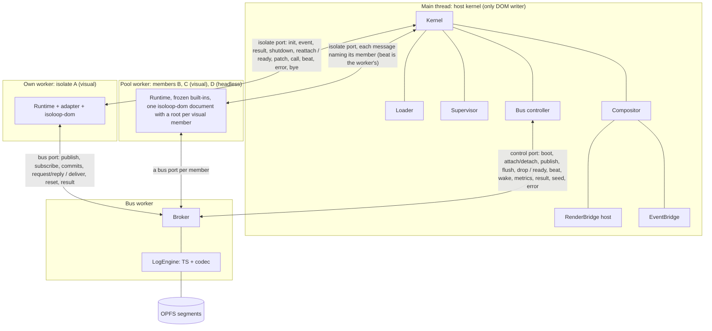
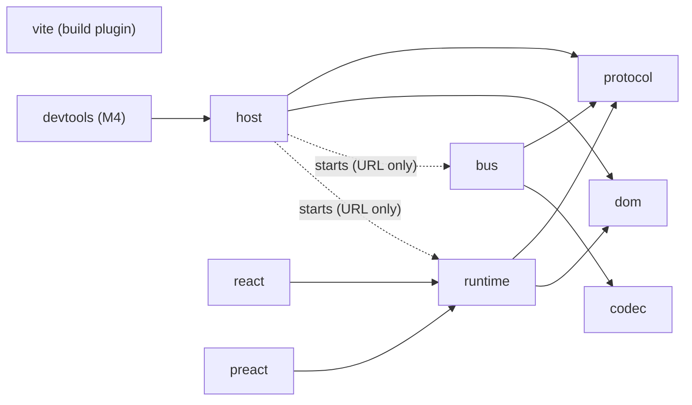
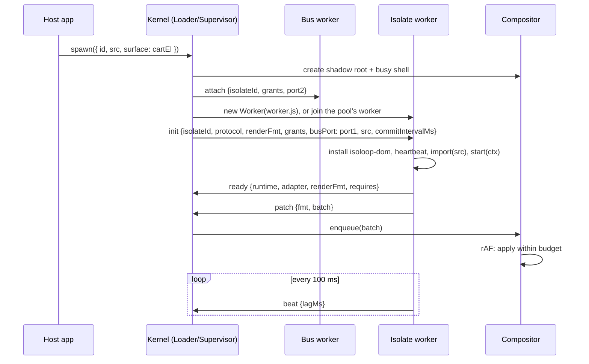
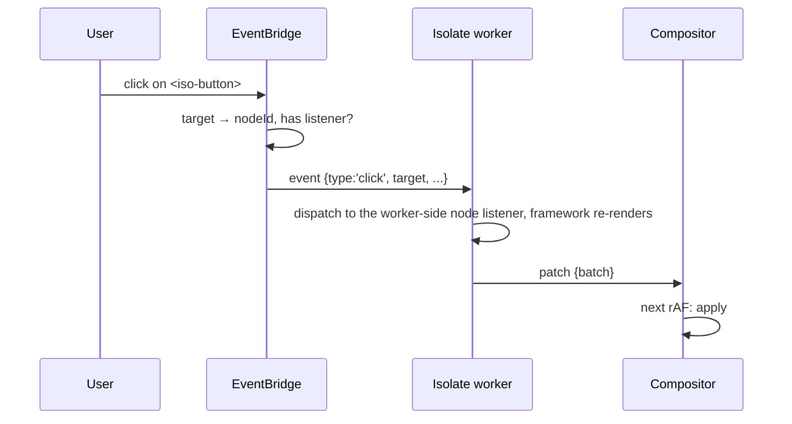
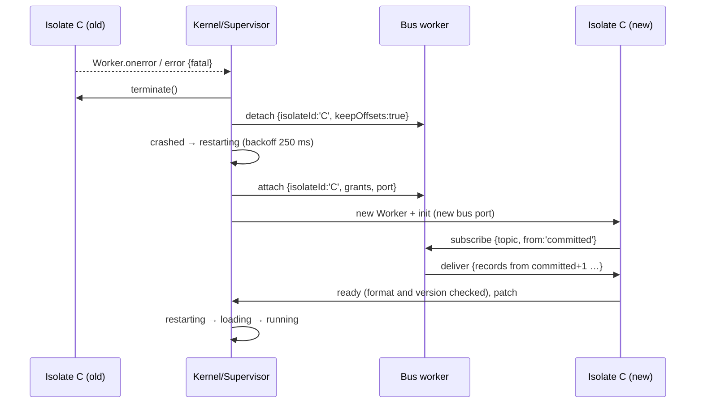

# Isoloop system design

- **Status:** Draft
- **Updated:** 2026-11-13 (as built through M2d, the ADR 0001 amendment and ADR 0016)
- **Builds on:** [RFC 0001](../rfcs/0001-threaded-runtime.md) (the *why* and the public shape) and the [ADRs](../adr/README.md) (individual decisions)

This document covers the *how*: runtime topology, package boundaries, the interfaces between modules, the main sequences, and the invariants tests must prove. When it disagrees with RFC 0001, this document wins and the RFC gets a note.

Package names use the `@isoloop/*` scope ([ADR 0004](../adr/0004-npm-name.md)).

**Terms** ([ADR 0008](../adr/0008-isolates-and-surfaces.md)): an *isolate* is the unit of isolation, meaning a code bundle with its own bus port, supervision and (if visual) surface. It runs in its own worker by default, or as a *member* of a named *pool* that shares one worker ([ADR 0001](../adr/0001-one-worker-per-isolate.md), [ADR 0015](../adr/0015-visual-pools.md)). A *visual* isolate has a *surface*, a host DOM element it renders into. A *headless* isolate has none: state stores, sync engines, calculators. Everything in this document applies to both, except the rendering parts (§4.4–4.8), which apply only to visual isolates.

## 1. Runtime topology

Three kinds of thread: the main thread, isolate workers (an own worker holds one isolate, a pool's worker several) and the bus worker. Four kinds of channel run between them.



| Channel | Ends | Carries | Created by |
| --- | --- | --- | --- |
| Isolate port | main ↔ isolate worker (the `Worker` itself) | `init`, `ready`, `patch`, `event`, `call`/`result`, `beat`, `error`, `shutdown`, `bye`, `reattach`. On a pool's worker every message names its member in `isolate`, except `beat`, which is the worker's | Loader |
| Bus port | isolate ↔ bus worker (`MessageChannel`), one per isolate, pool members included | `publish`, `subscribe`, `unsubscribe`, `commits`, `request`, `reply`, `deliver`, `reset`, `result` | Bus controller, at each isolate start |
| Control port | main ↔ bus worker (the `Worker` itself) | `boot` (contracts URL and topic configs), `attach`, `detach`, host-side `publish`, `flush`, `drop`; back: `ready`, `beat`, `wake`, `metrics`, `result`, `seed`, `error` | Bus controller |
| Canvas handoff | main → isolate worker, once | a transferred `OffscreenCanvas` | Compositor, on request |

**Rule:** no topic record crosses the main thread, except records the host itself publishes or subscribes to through `kernel.publish` / `kernel.subscribe` ([ADR 0005](../adr/0005-bus-topology-message-channels.md)). `kernel.subscribe` opens its own bus port, attached as `isoloop:host:<n>`, so ids starting with `isoloop:` are reserved for the kernel.

**Placement** is the host manifest's choice: without `pool` an isolate gets its own worker; with `pool: '<name>'` it joins that pool's worker, which starts with its first member and ends after its last. Members share the worker's event loop, globals (built-ins frozen before the first member loads), its one `isoloop-dom` document and its fate, and keep their own bus port, grants, offsets, surface and supervision ([ADR 0001](../adr/0001-one-worker-per-isolate.md), [ADR 0015](../adr/0015-visual-pools.md); [pools guide](../guide/pools.md)).

## 2. Packages and dependency rules



| Package | Runs in | Depends on | Must not depend on |
| --- | --- | --- | --- |
| `@isoloop/protocol` | everywhere | nothing | anything |
| `@isoloop/codec` | bus worker, Node | nothing | DOM types |
| `@isoloop/bus` | bus worker, Node | `protocol`, `codec` | DOM types, `host`, `runtime` |
| `@isoloop/dom` | isolate worker (`/worker`), main thread (`/host`) | nothing at runtime (`/testing`: optional peer on Vitest) | any `@isoloop/*` package; DOM types in `/worker` |
| `@isoloop/host` | main thread | `protocol`, `dom/host` | `runtime`, `bus` source (it loads their bundles by URL) |
| `@isoloop/runtime` | isolate worker | `protocol`, `dom/worker` | `host`, `bus` |
| `@isoloop/react`, `@isoloop/preact` | isolate worker | `runtime`, the framework (peer dep) | `host` |
| `@isoloop/devtools` (M4) | main thread | `host` | `runtime` |

Enforced by pnpm's strict `node_modules` (a package can only import what its `package.json` lists) plus an oxlint `no-restricted-imports` rule per package ([ADR 0009](../adr/0009-toolchain.md)). `bus` builds with `lib: ["ES2022", "WebWorker"]` minus DOM, so a stray DOM type fails the build; its tests run in Node.

Two packages ship a prebuilt worker entry, loaded by URL: `@isoloop/bus/worker` (`bus-worker.js`) and `@isoloop/runtime/worker`, a tiny entry that holds the host's first messages and imports `@isoloop/runtime/bootstrap`. Keeping the entry tiny means no other chunk imports it, which matters because WebKit evaluates a module worker's entry again when one of its own modules imports it ([engine constraints](../investigations/engine-constraints.md)); the bootstrap's once-per-worker guard covers workers started from `/bootstrap` directly. Users serve them from their origin and pass the URLs in `KernelConfig.workers`; `@isoloop/vite` provides them as `virtual:isoloop/workers`.

## 3. `@isoloop/protocol`

Pure types plus tiny guard functions. Everything else imports message shapes from here.

```ts
export const PROTOCOL = { v: 1, min: 1 } as const;

export type Envelope<T extends string, P> = {
  v: 1;              // protocol version
  t: T;              // message type
  id?: string;       // set when a reply is expected
  re?: string;       // id of the message this replies to
  isolate?: string;  // on a pool's isolate port: the member a message is for or from; absent on an own worker's port and on beat
  p: P;
};

// Isolate port: host → isolate
export type HostToIsolate =
  | Envelope<'init', InitPayload>
  | Envelope<'event', SerializedEvent>
  | Envelope<'result', CallResult>
  | Envelope<'shutdown', { reason: ShutdownReason; graceMs: number }>
  | Envelope<'reattach', { busPort: MessagePort }>;             // new bus port after a bus restart (ADR 0007)

// Isolate port: isolate → host
export type IsolateToHost =
  | Envelope<'ready', { runtime: string; adapter: string; renderFmt: string; requires?: string }>   // requires: the Isoloop major.minor it was built against (ADR 0012)
  | Envelope<'patch', { fmt: string; batch: unknown; styles?: string[]; head?: string[] }>   // styles: sheets added since the last patch (§4.8); head: tags put in the worker's head
  | Envelope<'call', { method: HostMethod; args: unknown[] }>
  | Envelope<'beat', { lagMs: number; heapBytes?: number; idle?: IdleReport; members?: Record<string, IdleReport> }>   // idle: own worker; members: a pool's members (ADR 0001)
  | Envelope<'error', ErrorPayload>
  | Envelope<'bye', {}>;                                         // last message after shutdown: handlers and last commits done, terminate now (§7.6)

// Bus port: isolate ↔ bus worker
type PublishId = { epoch?: number; seq?: number };              // dedups re-sends on persistent topics (ADR 0007, step 5)
export type IsolateToBus =
  | Envelope<'publish', { topic: string; key?: string; value: unknown } & PublishId>   // id set → result
  | Envelope<'subscribe', { topic: string; from: StartPosition; group?: string }>
  | Envelope<'unsubscribe', { topic: string }>
  | Envelope<'commits', { offsets: { topic: string; offset: number }[] }>   // highest settled offset per subscription, at most once per commit interval (ADR 0016)
  | Envelope<'request', { topic: string; key?: string; value: unknown; timeoutMs: number } & PublishId>  // id required; answer comes as result {re}
  | Envelope<'reply', { topic: string; offset: number; value: unknown }>;   // answers the request record at offset
export type BusToIsolate =
  | Envelope<'deliver', { topic: string; records: BusRecord[]; gap?: { from: number; to: number } }>
  | Envelope<'reset', { topic: string; reason: 'bus_restart' }>    // memory topic lost in a bus restart (ADR 0007)
  | Envelope<'result', CallResult>;

// Control port: host ↔ bus worker
export type HostToBus =
  | Envelope<'boot', { contractsUrl: string; topics: TopicConfig[]; heartbeatMs?: number; dev?: boolean; safeMode?: boolean; restart?: boolean }>   // topics: for the boot check (ADR 0003); safeMode: set the newest segments aside (ADR 0007)
  | Envelope<'attach', { isolateId: string; grants: Grants; port: MessagePort; reattach?: boolean }>   // reattach: after a bus restart, memory topics answer with reset (ADR 0007)
  | Envelope<'detach', { isolateId: string; keepOffsets: boolean; wake?: boolean }>                  // wake: suspended; the bus sends wake on a record (ADR 0001)
  | Envelope<'publish', { topic: string; key?: string; value: unknown } & PublishId>
  | Envelope<'flush', {}>                                    // the page is freezing or leaving: write the pending batch now
  | Envelope<'drop', { topic: string; force: boolean }>;     // kernel.dropTopic (ADR 0003, decision 19)
export type BusToHost =
  | Envelope<'ready', { engine: string; storage: 'memory' | 'opfs'; restored: { topic: string; head: number }[];
                        quarantined?: string[]; degraded?: DurabilityDegraded; orphaned?: { names: string[]; bytes: number } }>
  | Envelope<'beat', { lagMs: number }>
  | Envelope<'wake', { isolateId: string; topic: string }>   // record for a suspended isolate (ADR 0001)
  | Envelope<'metrics', BusMetrics>
  | Envelope<'result', CallResult>                          // answers a host publish sent with an id
  | Envelope<'seed', SeedEvent>                             // seeding news (ADR 0003, decision 18)
  | Envelope<'error', ErrorPayload>;   // fatal + contracts code: the bus can't start, no retry (ADR 0003)

export type InitPayload = {
  isolateId: string;
  protocol: { min: number; max: number };
  renderFmt: string;              // 'isoloop-dom@1', or 'none' (headless)
  config: unknown;                // manifest.config, passed through
  grants: Grants;
  busPort: MessagePort;           // transferred
  heartbeatMs: number;
  src: string;                    // isolate module URL, imported by the bootstrap
  wake?: boolean;                 // woken from suspension: `latest` subscriptions start from `committed`
  commitIntervalMs?: number;      // KernelConfig.bus.commitIntervalMs, default 100 (ADR 0016)
};

export type IdleReport = { sinceDeliveryMs: number; inFlight: number; holds: { ageMs: number; stack?: string }[] };
export type ErrorPayload = { message: string; stack?: string; fatal: boolean; code?: ErrorCode };

export type BusRecord = { offset: number; key?: string; value: unknown; ts: number; producer: string; req?: { from: string; id: string } };   // req: set on bus.request records
export type StartPosition = 'latest' | 'earliest' | 'committed';
export type Grants = { publish: string[]; subscribe: string[]; navigate?: boolean };   // navigate: programmatic navigate() allowed (ADR 0002), default false
export type HostMethod = 'measure' | 'focus' | 'navigate' | 'scrollIntoView' | 'requestCanvas';
export type CallError = { code: ErrorCode; message: string; issues?: { message: string; path: (string | number)[] }[] };
export type CallResult = { ok: true; value: unknown } | { ok: false; error: CallError };
```

The source of truth is `packages/protocol/src` (`envelope.ts`, `isolate.ts`, `bus.ts`, `control.ts`, `commits.ts`, `errors.ts`); this block follows it.

`init` / `ready` are the version handshake. The host sends its supported range. The isolate replies with the runtime version and render format it actually uses, or posts `error { fatal: true, code: 'protocol_mismatch' }`. Each side drops (and counts) envelopes with an unknown `v` or `t`, so old isolates don't crash on new message types.

The package also exports `isEnvelope`, `assertNever`, the error-code list (`ERROR_CODES`), the `Grants` matchers (`matchTopic`, `matchAny`; topic globs like `catalog.*`), `BusError` (what `publish`, `request` and `reply` reject with), the system topics (`SYSTEM_TOPICS`, `systemTopic`), and the structural topic types host and runtime use so they never import `bus`: `TopicRef`, `TypedRecord`, `SchemaTypes`, `ContractsList` and `topicConfigOf`. It also exports `routeTopic` (`isoloop.route.v1`, value `{ href, pathname, path, search, hash, state }`, [ADR 0002](../adr/0002-host-owns-routing.md)). Routing error codes: `cross_origin`, `routing_disabled`, `navigate_failed`.

Some codes never travel on a port: the host API throws them as a `KernelError`. `createKernel` throws `unsupported_browser`, with every missing feature named, when the browser lacks module workers, `MessageChannel`, adopted stylesheets on a `ShadowRoot`, or OPFS ([ADR 0009](../adr/0009-toolchain.md#rules) rule 7). `createKernel` also throws `invalid_config` for a malformed `components` entry. `spawn` throws `invalid_manifest` and `bus_failed` (§4.1).

## 4. `@isoloop/host`

### 4.1 Kernel

The public façade and wiring point. It owns no logic of its own beyond configuration and the event emitter.

```ts
createKernel(config: KernelConfig): Kernel

type KernelConfig = {
  workers: { isolateBootstrap: string; bus?: string; budget?: number };   // bundle URLs (§2); budget = soft worker-count warning, default 32 (ADR 0001)
  contracts?: { url: string; list: ContractsList };   // url: ES module the bus worker imports; list: its default export, imported by the host (ADR 0003)
  components?: Record<string, HostComponent>;   // HostComponent = { tag: string; attributes?: string[] }: isolate tag → host custom element (§4.5)
  supervisor?: { strategy?: 'one-for-one' | 'never'; maxRestarts?: number; withinMs?: number; backoff?: Partial<Backoff> };
  heartbeat?: { everyMs?: number; blockedAfterMs?: number; killAfterMs?: number; readyTimeoutMs?: number };
  compositor?: { frameBudgetMs: number };
  styles?: readonly CSSStyleSheet[];        // adopted into every surface's shadow root (§4.8)
  suspend?: { maxConcurrentWakes?: number };   // default 4 (ADR 0001)
  routing?: boolean;                        // default true; false = no route topic, no link interception, navigate rejects routing_disabled (ADR 0002)
  basePath?: string;                        // default '/'; must match the host router's basename
  onNavigate?: (req: NavigateRequest) => boolean | Promise<boolean>;   // default: history.pushState/replaceState; true = accepted, not finished
  dev?: boolean;                            // default false; dev checks: structuredClone of schema outputs (ADR 0003), the 10-minute keepAwake warning, the basePath warning (ADR 0002)
  bus?: { commitIntervalMs?: number };      // default 100, integer 0–1,000 (0 = every task); invalid_config otherwise (ADR 0016)
};

type NavigateRequest = { href: string; replace: boolean; state?: unknown; from: string };   // href absolute, same-origin; from = isolate id

interface Kernel {
  spawn(manifest: IsolateManifest): IsolateHandle;     // manifest.surface optional (ADR 0008); manifest.pool: headless or visual (M2c, ADR 0015);
                                                       // manifest.suspend: 'never' (default) | 'when-idle' | { whenIdle: { afterMs } } (ADR 0001)
  stop(id: string): Promise<void>;
  restart(id: string): Promise<void>;
  resume(id: string): Promise<void>;                   // wake a suspended isolate (ADR 0001); no-op unless suspended
  publish<In>(topic: TopicRef<In>, rec: { key?: string; value: In }): Promise<void>;   // rejects with a BusError
  subscribe<Out>(topic: TopicRef<unknown, Out>, fn: (r: TypedRecord<Out>) => void, opts?: { from?: StartPosition }): () => void;   // from 'latest' by default
  on(event: KernelEvent, fn: (e: any) => void): () => void;   // isolate:state, isolate:ready, isolate:crash, isolate:failed, isolate:error, workers:budget, bus:ready, bus:crash, bus:recovered, bus:durability-degraded, bus:quota, bus:restart, bus:failed, bus:metrics, route:state_dropped, route:navigate_error; M2b adds bus:seeded, bus:seed_rejected, bus:orphaned_topics
  isolates(): IsolateSnapshot[];                                      // used by devtools; `pool` for pool members (M2c)
  pools(): PoolSnapshot[];                                            // M2c: members, worker running, effective grants (union); ADR 0015: sharesDocument, warning
  syncRoute(): void;                                   // host router changed the URL; republish isoloop.route.v1 if href/state differ (ADR 0002)
  dropTopic(name: string, o?: { force?: boolean }): Promise<void>;   // M2b: delete an orphaned persistent topic; seed_pending / force rules (ADR 0003)
  destroy(): Promise<void>;
  readonly debug: { crashBus(): void; messages(): Record<string, number> };   // internal test hooks, not API: messages() counts main-thread messages by type (I7)
}
```

`IsolateManifest` is `{ id, src, surface?: Element, config?, grants?, fallback?, pool?, suspend?, bus?: { onReset? } }` (`packages/host/src/kernel.ts`).

Defaults: heartbeat `100 / 400 / 10_000` ms, ready timeout `10_000` ms, frame budget `8` ms, supervisor `one-for-one`, 3 restarts in 60 s, backoff `250 ms × 2ⁿ` capped at 4 s.

`contracts` and `workers.bus` come together: giving only one throws `invalid_config`. Without both there is no bus worker: isolates get an unconnected bus port and `kernel.publish` rejects with `bus_unavailable`.

`createKernel` stays synchronous, so isolates start while the bus loads its contracts. If loading fails, every isolate fails with reason `bus-failed` (no restart) and `bus:failed { code }` is emitted ([ADR 0003](../adr/0003-schema-format-standard-schema.md), decision 7). `spawn` throws a `KernelError` with a `code`: `invalid_manifest` (also for ids starting with `isoloop:`, which name the kernel's own bus connections), or `bus_failed` once the bus couldn't load its contracts. `kernel.publish` rejects with a `BusError` carrying the broker's code. A host publish the bus never answered before it crashed is sent again to the new bus, as isolates re-send theirs, and each carries `(epoch, seq)` so a persistent topic answers a record it already wrote with its original offset (§5, [ADR 0007](../adr/0007-bus-worker-supervision.md) steps 5 and 6); host publishes made while the bus restarts are queued. Once the bus has failed for good, isolates get a port that answers every call with `bus_unavailable`.

With `suspend` set, an isolate subscribed to a `last-n` or `time` topic gets a console warning, since records may expire while it sleeps. It comes from the bus metrics, so about a second after the subscribe. The manifest's `bus: { onReset: 'restart' }` opts an isolate into a restart instead of `reset` after a bus restart ([ADR 0007](../adr/0007-bus-worker-supervision.md)). Hosting requirements (CSP, CORS) are in [the hosting guide](../guide/hosting.md).

### 4.2 Loader

Turns a manifest into a running worker.

1. Resolve `src`. A URL is used as is. A Module Federation remote (`mf:<remote>/<expose>`) is resolved through a pluggable `resolveRemote` hook (M3+).
2. Ask the bus controller for a bus port: it sends `attach` with the other end to the bus worker first, so the port is wired before the isolate starts.
3. Without `pool`, create `new Worker(isolateBootstrap, { type: 'module', name: isolateId })`. With `pool`, join that pool's worker, creating it (`name: 'pool:<name>'`) if this is its first member. Workers must be same-origin, so isolate code is never the worker script itself. The bootstrap `import()`s the isolate module at `init.src`. That works cross-origin when the isolate CDN sends CORS headers.
4. Post `init` with the bus port transferred; in a pool it names the member in `isolate`.
5. Hand the isolate to the supervisor (state `Loading`).

Ending an isolate terminates an own worker. A pool member leaves instead: the loader sends it `shutdown` inside the shared worker, and terminates the worker only after its last member. A member that restarts alone rejoins the running worker.

CSP needs: `worker-src 'self'`, `script-src` allowing the isolate CDN (for `import()` inside the worker), and `connect-src` to match. The docs list these.

The M0 proof of concept prepended the runtime to a blob, which needed `worker-src blob:` and didn't support cross-origin ES modules; the bootstrap replaced it in M1.

### 4.3 Supervisor

A pure state machine per isolate plus timers, separated so it can be unit-tested with fake clocks:

```ts
type IsolateState = 'loading' | 'running' | 'blocked' | 'stopped' | 'crashed' | 'restarting' | 'failed' | 'suspended';
type SupervisorInput =
  | { k: 'spawned'; at: number } | { k: 'ready' } | { k: 'beat'; at: number; lagMs: number } | { k: 'tick'; at: number }
  | { k: 'error'; at: number; fatal: boolean; message: string } | { k: 'workerError'; at: number; message: string }
  | { k: 'spawnFailed' | 'renderFmtMismatch' | 'busFailed'; at: number; message: string }
  | { k: 'versionMismatch'; at: number; reason: 'runtime-too-old' | 'isolate-too-old'; message: string }
  | { k: 'poolCrash'; at: number; reason: CrashReason; message: string }   // another member took the shared worker down (M2c)
  | { k: 'stop' } | { k: 'respawn' } | { k: 'suspend' } | { k: 'wake' } | { k: 'hidden' } | { k: 'visible'; at: number };
type SupervisorEffect =
  | { k: 'terminate' } | { k: 'spawn'; afterMs: number } | { k: 'shutdown'; graceMs: number }
  | { k: 'showBusy' | 'hideBusy' } | { k: 'suspend'; graceMs: number } | { k: 'wake' }
  | { k: 'showFallback'; reason: CrashReason; message: string } | { k: 'hideFallback' }
  | { k: 'emit'; event: KernelEvent; data: unknown };

function step(s: IsolateSupervision, input: SupervisorInput): { s: IsolateSupervision; effects: SupervisorEffect[] };
```

The source is `packages/host/src/supervisor/machine.ts`. `crashed` is passed through, never rested in.

Transitions (matching the RFC lifecycle diagram):

| From | Input | To | Effects |
| --- | --- | --- | --- |
| loading | `ready` | running | emit `isolate:ready` |
| loading | `ready` with a `renderFmt` the host doesn't speak | failed | reason `render-fmt-mismatch`, no restart ([ADR 0011](../adr/0011-dom-package.md)); showFallback, emit `isolate:failed` |
| loading | `ready` with a `requires` outside `[FLOOR, VERSION]` | failed | reason `runtime-too-old` (newer than `VERSION`) or `isolate-too-old` (older than `FLOOR`), no restart ([ADR 0012](../adr/0012-isolates-built-apart.md)); showFallback, emit `isolate:failed` |
| loading | tick past `readyTimeoutMs` | crashed | terminate |
| running | tick, no beat for `blockedAfterMs` | blocked | showBusy |
| blocked | `beat` | running | hideBusy |
| blocked | tick, no beat for `killAfterMs` | crashed | terminate |
| running / blocked | `workerError` or fatal `error` | crashed | terminate, emit `isolate:crash` |
| loading / running / blocked | `poolCrash`: another member of its pool crashed with `unresponsive` or `worker-error` | crashed | with that member's reason; every member restarts, in a new worker |
| crashed | restarts in window < max | restarting | spawn after backoff |
| crashed | restarts in window ≥ max, or strategy `never` | failed | showFallback, emit `isolate:failed` |
| restarting | `spawned` | loading | – |
| any but failed | `stop` | stopped | `shutdown` with grace, then terminate |
| failed / stopped | `respawn` | restarting, then `spawned` → loading | resets restart window |
| any but failed | `busFailed` (contracts couldn't load) | failed | reason `bus-failed`, no restart; showFallback, emit `isolate:failed` |
| running | `suspend` set, idle for `afterMs` (no visible surface, no deliveries, no `keepAwake` hold, nothing in flight; ADR 0001) | suspended | `shutdown` with grace, `detach { keepOffsets: true, wake: true }` (leaves consumer groups), terminate, keep surface snapshot |
| suspended | surface visible (visual), bus `wake` (headless), `resume`, or a bus restart (every suspended headless isolate, since the new bus has lost their wake subscriptions; [ADR 0001](../adr/0001-one-worker-per-isolate.md), Suspension) | loading | queued: at most `suspend.maxConcurrentWakes` (4) spawns at once, visible first; `latest` subscriptions start from `committed` (`init.wake`); restart window untouched |
| any | `spawn-failed` | crashed | reason `spawn-failed`; before the retry, suspend every idle suspendable isolate |
| any | document hidden | (same) | pause hang judgement (no showBusy, no kill) |
| any | document visible, or Page Lifecycle `resume` | (same) | reset every heartbeat clock (isolates and bus) |

Non-fatal `error` messages (a caught exception in a handler) are only reported (`isolate:error`). They don't change state.

**Pools** (M2c, M2d). The heartbeat is the worker's, so the members of a pool block and are killed together. A crash that is the worker's (`unresponsive`, `worker-error`) crashes every other member with the same reason (`poolCrash`): the worker is terminated with its last member and they all restart in a new one, each replaying from its own committed offsets. A member's own fatal error, ready timeout or version mismatch stays its own: it restarts alone, back into the running worker. Any member's wake condition wakes the whole pool, and a pool suspends only as a whole ([ADR 0001](../adr/0001-one-worker-per-isolate.md)).

The supervisor also tracks the bus worker. A bus crash doesn't restart isolates: they get a new bus port (`reattach`) and keep running ([ADR 0007](../adr/0007-bus-worker-supervision.md), §7.7).

### 4.4 Compositor

Owns every surface in the DOM and is the **only** code that writes to it.

- When an isolate with a `surface` spawns, it creates `<iso-surface data-isolate-id>` in that target. That element is the shadow host; the shadow root holds the isolate's adopted stylesheets, a busy overlay and a fallback slot. Headless isolates get no surface and never reach the compositor.
- Each isolate has a FIFO of `PatchBatch`es. `patch` messages enqueue and schedule one `requestAnimationFrame`.
- **Per frame:** start at a rotating isolate index (round-robin fairness), apply whole batches while `performance.now() - frameStart < frameBudgetMs`, and always apply at least one batch per frame so progress is guaranteed. Batches left over roll to the next frame. Batches are never split, since a batch is one atomic UI state.
- Within a frame, isolates take turns **one batch at a time**, so a chatty isolate can't spend the whole budget before the others get a turn.
- Exposes `stats()` per isolate for devtools and metrics: `queued`, `applied`, `rejected` (malformed batches), `dropped` (discarded by a restart; a stop removes the surface and its queue) and `lastFrameMs` (ms applied in the last frame it had work). Tests inject the clock and the frame scheduler.
- On restart it clears the isolate's queue and its shadow content, then keeps the shell (busy/fallback UI) in place.

### 4.5 RenderBridge (host side)

Applies `isoloop-dom@1` batches from an isolate's worker-side DOM subset ([ADR 0010](../adr/0010-own-render-bridge.md)). It has no dependency. A batch is a list of plain records keyed by our node ids: `insert`, `move` (one record, so node identity survives), `remove`, `text`, `attr`, `prop` and `listen`. Every tag, attribute and URL goes through the component registry first.

**Visual pools ([ADR 0015](../adr/0015-visual-pools.md)).** A pooled worker keeps one subset document, and each visual member renders into its own root element in it. The worker sends each member's records on that member's envelope, with the member's root as `ROOT_ID`, so each surface keeps its own applier and the format is unchanged; events and host calls come back for a member, and a node id another member holds is `not_found`. Moving a node between members' roots throws in the worker. Consequences: members of a pool can read each other's DOM and input (so secrets stay on their own worker), share one focus and one frame loop, and a render error the adapters catch at a member's root is that member's own, while an error from a shared scheduler restarts the pool.

```ts
interface HostRenderBridge {
  readonly fmt: string;                                    // 'isoloop-dom@1'
  mount(root: ShadowRoot, send: (event: SerializedEvent) => void): void;   // the registry is given when the bridge is created
  apply(batch: unknown): boolean;                          // called only by the Compositor; false = malformed, nothing changed
  idFor?(node: Node): string | undefined;                  // for the EventBridge; optional for test bridges
  nodeFor?(id: string): Element | undefined;               // for measure/focus; optional for test bridges
  unmount(): void;
}
```

**Component registry** (`render/registry.ts`). An allow-list of safe HTML tags (the M0 proof of concept's list plus headings, `br`, `hr`, `a`, `img`, `table` family, `form` family, and an `svg` subset for icons and charts), plus host components (`iso-button` → design-system element) registered through `KernelConfig.components`. Unknown tags render as `div` (`g` inside SVG). Attributes are allow-listed per tag (global, `aria-*` and `data-*` everywhere). `script`, `iframe`, `object`, `embed`, `style`, `foreignObject`, `on*` attributes and `srcdoc` are never created. `href`/`src` are restricted to `http(s):`, `mailto:` and relative URLs, after stripping the whitespace and control characters browsers ignore in a scheme. SVG `<use>` may only reference the same document (`#id`). Form `action`/`formaction` are dropped (submits are always prevented, §4.6). Isolates may set only the `value`, `checked` and `selected` properties. With routing on, same-origin `<a href>` is rewritten to the absolute URL from the route resolver (`/x` → `basePath + x`) on render and on every patch that changes it ([ADR 0002](../adr/0002-host-owns-routing.md)).

### 4.6 EventBridge and inputs

- One listener per event type on each shadow root, for a fixed set: `click`, `dblclick`, `input`, `change`, `keydown`, `keyup`, `submit`, `focusin`, `focusout`, `pointerdown`, `pointerup`. Pointer moves are opt-in per node and throttled to one per frame. So is `scroll` (M3b, for the dashboard's virtualized table), caught in the capture phase because it doesn't bubble; it carries the element's `scrollTop` and `scrollLeft`, which the worker DOM mirrors on the element as read-only `scrollTop` and `scrollLeft`. The host owns scrolling: an isolate can't set them.
- An event fires only if the isolate registered a listener for `(nodeId, type)` on the target or an ancestor. Those registrations travel in patches.
- Serialized event: `{ type, target: nodeId, currentTargets: nodeId[], value?, checked?, key?, code?, mods, x?, y?, button?, scrollTop?, scrollLeft? }`.
- **Default actions:** `submit` and with routing on, plain primary-button clicks on same-origin `<a>` (hash-only included) are always prevented on the host and go to `onNavigate` with `from` set to the isolate; they need no `navigate` grant. Clicks with a modifier key, a non-primary button, `target` other than `_self`, or `download` keep the browser's behaviour ([ADR 0002](../adr/0002-host-owns-routing.md)). Other defaults run normally. An isolate can't call `preventDefault` synchronously, so the docs list this limit.
- **Host-owned inputs:** `input`, `textarea` and `select` keep their own value and caret on the host. The isolate gets `input` events with the value. A `value` from the isolate is applied only if it differs from the live value and the element isn't focused. A `force` option for focused inputs is planned for M3a ([task 6](../plans/m3a-adapters.md#6-force-for-host-owned-inputs)). That avoids caret jumps and the per-keystroke round trip.

### 4.7 Host calls

`call` → `result`, with a 5 s default timeout on the isolate side (`timeout`). The isolate flushes its pending patches before it posts a call, and the host runs DOM calls through the compositor after every batch queued before them. A node id that names no rendered node fails with `not_found`; a method the host doesn't know with `unsupported`; DOM calls and `requestCanvas` from a headless isolate with `no_surface`.

| Method | Behaviour |
| --- | --- |
| `measure(nodeId)` | `getBoundingClientRect` relative to the surface, read in the next rAF after pending patches apply |
| `focus(nodeId)` / `scrollIntoView(nodeId, opts)` | Applied after pending patches |
| `navigate({ href, replace, state })` | Needs `grants.navigate`, else `forbidden`; `routing_disabled` when routing is off. `/x` resolves against `basePath`, other hrefs against the document URL; cross-origin rejects with `cross_origin`. Otherwise goes through `onNavigate` with `from` set to the isolate id; result is `true` (accepted) / `false` (refused), a throw rejects with `navigate_failed`. After `true` the kernel runs `syncRoute()` and, if it published, replies after the bus commit (at once if the bus is down). Available to headless isolates |
| `requestCanvas(nodeId, { width, height })` | Host takes the `<canvas>` it rendered for that node (anything else is `not_found`), sets `width` and `height` if given, calls `transferControlToOffscreen()`, and returns the `OffscreenCanvas` as a transferable. A `ResizeObserver` then sends `event { type: 'resize', width, height }` (CSS pixels) to the canvas node, the first at once. Each canvas goes once; a second request is `invalid`. Built in M3a |

### 4.8 Styles

An isolate calls `ctx.styles(css)`, and the stylesheet text travels with its next patch in a side channel (`patch.styles: string[]`, the sheets added since the last patch; a styles-only change sends an empty batch). The compositor turns each into a `CSSStyleSheet` just before that batch applies and adopts it after the shell's and the kernel's sheets (`KernelConfig.styles`). A restart drops the isolate's sheets. Host design tokens pass through CSS custom properties, which inherit through the shadow boundary. Headless isolates' `styles()` is a no-op.

## 5. `@isoloop/runtime`

The runtime that runs inside each isolate worker.

- **Worker entry** (`@isoloop/runtime/worker`): holds the host's first messages, imports the bootstrap and replays them in order (§2). The bootstrap starts once per worker, under a marker on the worker's global.
- **Own worker or pool:** an `init` without `isolate` makes the worker an own worker, which takes one `init`; an `init` with `isolate` makes it a pool, which takes one per member. Before a pool's first member loads, the bootstrap freezes the built-ins, so one member can't patch them for the others; the properties V8 protects stay plain data so its fast paths survive ([ADR 0001](../adr/0001-one-worker-per-isolate.md), override taming, 2026-11-12). Visual members share one `isoloop-dom` document, each rendering into its own root ([ADR 0015](../adr/0015-visual-pools.md)).
- **Bootstrap** (`@isoloop/runtime/bootstrap`): for each member, waits for `init`, checks the protocol range, installs the `isoloop-dom` DOM subset as `document` and the DOM globals if the isolate has a surface ([ADR 0010](../adr/0010-own-render-bridge.md); skipped when `renderFmt` is `'none'`), starts the heartbeat, connects the bus port, then `await import(init.src)`. The isolate module's default export is an `IsolateDefinition`, and the bootstrap calls `definition.start(ctx)`.
- **Heartbeat:** one per worker, `setInterval(everyMs)`. `lagMs = max(0, now - last - everyMs)`. Adds `performance.memory.usedJSHeapSize` where available. A pool's beat carries each member's idle report.
- **Errors:** `self.onerror` and `onunhandledrejection` post `error { fatal: false }`. A throw during `start` is fatal. The host also catches `Worker.onerror` for errors the runtime can't see.
- **IsolateContext** (what adapters build on):

```ts
interface IsolateContext<Root = IsolateRoot> {
  id: string;
  config: unknown;
  root: Root | undefined;                          // render target (isoloop-dom subset); undefined when headless
  bus: BusClient;
  host: { measure(node): Promise<Rect>; focus(node): Promise<void>;
          scrollIntoView(node, opts?): Promise<void>;
          navigate(href: string, o?: { replace?: boolean; state?: unknown }): Promise<boolean>;
          requestCanvas(node, size?: { width?: number; height?: number }): Promise<OffscreenCanvas> };
          // takes worker-side nodes
  styles(css: string | string[]): void;
  onShutdown(fn: (reason: ShutdownReason) => void | Promise<void>): void;   // reason includes 'suspend'
  keepAwake(): () => void;                         // hold against suspension; call the result to release (ADR 0001)
}

interface BusClient {
  publish<In>(topic: TopicRef<In>, rec: { key?: string; value: In }): Promise<void>;   // rejects with a BusError on schema/ACL error
  subscribe<Out>(topic: TopicRef<unknown, Out>, fn: (r: TypedRecord<Out>) => void | Promise<void>,
               opts?: { from?: StartPosition; group?: string; autoCommit?: boolean; onReset?: () => void; onGap?: (g: { from: number; to: number }) => void }): () => void;
  request<In, ROut>(topic: TopicRef<In, unknown, unknown, ROut>, value: In, opts?: { key?: string; timeoutMs?: number }): Promise<ROut>;   // reply schema only; timeout default 30 s
  reply(record: TypedRecord<unknown>, value: unknown): Promise<void>;   // validated against the reply schema; invalid / already_replied (ADR 0003)
  commit(record: TypedRecord<unknown>): void;      // for autoCommit: false
}
```

`subscribe` with `autoCommit` (default `true`) counts a record as settled once its handler's promise resolves. Settled offsets go out together: one `commits` message per port, at most once per `commitIntervalMs` (default 100 ms), earlier when a subscription reaches half its credit, and on shutdown, where the client waits for the broker's answer before `bye` ([ADR 0016](../adr/0016-fewer-messages-per-record.md)). Delivery is at least once, and a crash can redeliver up to one interval of records, so handlers must be idempotent (stated in the docs).

`defineIsolate(fn)` in each adapter wraps a framework component into an `IsolateDefinition`. Vanilla and headless isolates export `{ start(ctx) {} }` directly; `@isoloop/runtime` exports `defineIsolate<Root>(def)` to type it (`defineIsolate<HTMLElement>` gives `ctx.root` the DOM's types in DOM-typed code). `onShutdown` handlers run when the host sends `shutdown`, and `bye` follows once they settle or the grace runs out (§7.6).

`ctx.bus` is the `BusClient` above (`packages/runtime/src/bus-client.ts`). `onReset` is for memory topics lost in a bus restart. Handlers run one record at a time, in order. A handler that throws is reported as a non-fatal `error` and stops that subscription's commits, so the record and those after it come back on the next start. On `reattach` the client drops its pending commits (the new broker would reject them before the subscriptions, so a persistent topic redelivers up to one interval, as after a crash), sends every subscription again, then every publish and request the old bus never answered, in order; past the inbox limit (1,000 unanswered) calls reject with `bus_unavailable`. Woken from suspension, an isolate's `latest` subscriptions start from `committed` (`init.wake`), so it replays what it missed; `onGap` reports records retention dropped meanwhile. Each beat carries an idle report (time since the last delivery, calls in flight, open `keepAwake()` holds with age and stack) that the kernel's idle check reads.

**Headless isolates** ([ADR 0008](../adr/0008-isolates-and-surfaces.md)) get the same bootstrap, heartbeat, error handling and `BusClient`, but no `isoloop-dom` subset and no `root`. `styles()` is a no-op, and the DOM host calls reject with `no_surface`. A typical headless isolate is a store: it subscribes to command topics, keeps state, and publishes snapshots to a compacted topic that visual isolates read with `from: 'earliest'`.

## 6. `@isoloop/bus`

No DOM, so it's testable in Node. The bus worker entry (`@isoloop/bus/worker`, `bus-worker.js`) is a thin shell that wires ports to a `Broker`.

### 6.1 Topics and records

```ts
type TopicDef<In, Out = In, RIn = never, ROut = RIn> = {
  name: string;                                  // 'cart.items.v1'
  schema: StandardSchemaV1<In, Out>;             // required; unchecked<T>() opts out (ADR 0003)
  reply?: StandardSchemaV1<RIn, ROut>;           // required for bus.request
  seed?: { from: TopicDef<any, any>; map: (value: unknown, rec: BusRecord) => In; follow?: boolean };   // M2b, ADR 0003
  retention: { kind: 'last-n'; n: number } | { kind: 'time'; ms: number } | { kind: 'compacted' };
  maxRecordBytes?: number;                       // default 256 KiB, rough estimate by structured size
  durability?: 'memory' | 'persistent';          // default 'memory'; 'persistent' = OPFS (ADR 0007); memory where OPFS isn't available
};
function topic<In, Out, RIn, ROut>(name: string, def: Omit<TopicDef<In, Out, RIn, ROut>, 'name'>): TopicDef<In, Out, RIn, ROut>;
function contracts(...topics: TopicDef<any, any, any, any>[]): Contracts;   // default export of the contracts module; rejects duplicate names
function unchecked<T>(): StandardSchemaV1<T, T>;
```

`TopicDef` objects are what host, isolates and the bus worker share through the contracts package ([ADR 0003](../adr/0003-schema-format-standard-schema.md)). On the wire only the name travels. The bus worker builds its topics only from the module at `contracts.url`; at `boot` it compares them with the host's `list` and fails with `contracts_mismatch` if they differ. `contracts_failed`, `contracts_invalid`, `contracts_mismatch` and `reserved_topic` (a contracts module exporting `isoloop.*`) are fatal and not retried: every isolate fails with `bus-failed` and the kernel emits `bus:failed` (§4.1; ADR 0003, decision 7). While the module loads, the bus accepts `attach`/`subscribe` and buffers publishes per port inside the bus worker, validated in order once the broker exists; past 1,000 they reject with `bus_unavailable` (ADR 0003, decision 8; the buffer across a bus restart is a separate one, on the isolate side). System topics are defined in `@isoloop/protocol` with hand-written validators.

**Seeding (M2b).** A topic with `seed` starts in a *seeding* state on a device where `seed.from` has data: its publishes are buffered and its subscribers get nothing until every `from` record has been mapped, validated against the new schema and appended (original `ts`/`producer` kept, progress stored atomically with the appends, so exactly once and resumable). Rejected records are skipped and reported (`bus:seed_rejected`), their offsets kept in the seed metadata; `bus:seeded { topic, copied, rejected }` marks the end. `map` must be synchronous (`seed_async` otherwise). `follow: true` keeps forwarding new `from` records while both topics are listed. Persistent topics no longer listed are reported as `bus:orphaned_topics` and kept until `kernel.dropTopic`, which rejects with `seed_pending` while a pending seed needs the topic and needs `{ force: true }` if rejected seed records from it are recorded.

### 6.2 LogEngine interface

```ts
interface LogEngine {
  createTopic(cfg: TopicConfig): void;
  append(topic: string, rec: Omit<BusRecord, 'offset'>): number;         // returns offset
  read(topic: string, fromOffset: number, max: number): BusRecord[];     // offsets ascending, may skip compacted/expired
  head(topic: string): number;                                           // next offset to be written
  tail(topic: string): number;                                           // oldest retained offset
  commit(topic: string, consumer: string, offset: number): void;
  committed(topic: string, consumer: string): number | undefined;
  compact(topic: string): void;                                          // retention pass
  durable(topic: string): boolean;                                       // appends go to disk: ack after flush
  flush(): Promise<void>;
  readable(topic: string, fromOffset: number): boolean;                  // false: evicted, call page first
  page(topic: string, fromOffset: number): Promise<void>;                // reads evicted records back in
}
```

The TS engine stores each topic as a chunked array plus, for compacted topics, a `Map<key, offset>`. Retention runs on append (`last-n`), on a 1 s timer (`time`), and at a dirty-ratio threshold (`compacted`). Offsets are monotonic per topic and never reused. The M5 WASM engine implements the same interface, and a shared conformance test suite runs against both.

A persistent topic keeps only its recent records in memory, about 8 MiB (`residentBytes`); older chunks are evicted, since they're on disk. When a subscription's cursor is on an evicted offset, the broker calls `page`, which reads the segment holding it back from disk, and pumps again once it's in.

**Storage under the engine** ([ADR 0007](../adr/0007-bus-worker-supervision.md)). The engine writes through a `LogStorage` for topics with `durability: 'persistent'`:

```ts
interface LogStorage {
  readonly kind: 'memory' | 'opfs';                               // reported in the bus `ready` message
  open(): Promise<StoredState>;                                   // segments + offsets found on disk
  appendBatch(topic: string, encoded: Uint8Array[]): void;        // buffered; group commit every 5 ms / 256 records
  flush(): Promise<void>;                                         // resolves when the batch is durable → publish acked
  saveOffsets(offsets: Record<string, Record<string, number>>): void;
  dropBelow(topic: string, tail: number): void;                   // retention on disk: whole segments
  rewrite(topic: string, keep: (offset: number, key?: string) => boolean): Promise<void>;   // compaction on disk
  readSegment(topic: string, fromOffset: number): Promise<Uint8Array[]>;      // replay of evicted segments
  quarantineNewest(): Promise<string[]>;                          // safe mode
}
```

`MemoryStorage` (M2) is a no-op. `OpfsStorage` (M2b) keeps one directory per topic, segment files of up to 4 MiB, and an offsets file, all accessed through sync access handles inside the bus worker, under the Web Lock `isoloop-bus` so only one tab writes. A bus that doesn't get the lock runs every topic in memory and reports `ready.degraded: 'another-tab'`, and the kernel emits `bus:durability-degraded { reason }`; a restarting bus waits up to 2 s for the one it replaces to let go. Records are encoded by a shared binary codec (`@isoloop/codec`, also used by M5).

### 6.3 Broker

Responsibilities, in order, for a `publish`:

1. **ACL:** the topic must match `grants.publish` for this isolate, or the result is error `forbidden`. System topics (`isoloop.*`) are always `forbidden` to isolates whatever the grants, and `kernel.publish` rejects them on the main thread; only the kernel's internal path publishes them. Every isolate may subscribe to them without a grant ([ADR 0002](../adr/0002-host-owns-routing.md)).
2. **Topic exists**, or error `unknown_topic`; a `request` needs a `reply` schema, or error `not_requestable`.
3. **Size** check, or error `too_large`.
4. **Schema:** `schema['~standard'].validate(value)`, or error `invalid` with the issues as `{ message, path }[]`. A promise is awaited, but appends stay in publish order per topic. While a topic seeds, its publishes wait in that order until the seed ends.
5. **Duplicate check** (persistent topics): a publish whose `(producer, epoch, seq)` is already on disk, a re-send after a bus crash, is answered with its original offset and not appended again ([ADR 0007](../adr/0007-bus-worker-supervision.md), step 5).
6. **Encodable and room:** a persistent topic's output must encode with the codec, or error `not_encodable`, and the origin's storage must have room, or error `quota_exceeded`. In dev builds, a memory topic's output is checked with `structuredClone` instead.
7. `engine.append` of the validated **output** (`result.value`), with `producer = isolateId` and `ts = Date.now()`. Records are never validated again on replay or restore.
8. Reply `result { ok, offset }`: at once for a memory topic, after the batch is on disk for a persistent one.
9. **Fan out:** push to each live subscription, and wake any suspended isolate waiting on the topic.

**Subscriptions and consumers.** The consumer id is `isolateId` (or `group:<name>` for groups). Offsets are kept by the engine keyed by consumer id, so they survive isolate restarts. On `subscribe`, the start offset is `latest` → `head`, `earliest` → `tail`, or `committed` → `committed + 1`, falling back to `earliest`.

**Groups.** Subscribers sharing a `group` get each record once among them, by hash of key (records with no key go round-robin). That keeps per-key order within a group while its membership is stable: if a record's member is out of credit, the group waits rather than skip ahead. The group's offset moves only past records every member has committed. A member that leaves hands its uncommitted records to the others, which get them before anything new.

**Delivery and backpressure (credits).** Each subscription has `credit`, starting at the inbox limit (default 1,000). The broker pushes `deliver` batches (up to 64 records, coalesced per microtask) while `credit > 0`, and subtracts the number sent. Each publish reaches the bus worker as its own task, so in practice a batch holds one record; batching across tasks is the [M5b spike](../plans/m5b-delivery-batching.md). Batching messages per port within a task was built and measured under [ADR 0016](../adr/0016-fewer-messages-per-record.md), cut port messages by 3–5% with no CPU change beyond the run spread, and was removed. A `commits` entry restores credit for the records it settles. At 0 credit the subscription is *paused*: nothing is queued in memory, only its read cursor is kept. When credit comes back, the broker reads from the log at the cursor. Records that expired while paused are skipped, and the isolate gets a `deliver` with `gap: { from, to }` so it can tell.

**Request/response.** `bus.request(topic, value)` sends `request { timeoutMs }`, which goes through the publish pipeline and is appended with `req: { from, id }` (the caller's isolate id and request id) on the record. Responders call `reply(record, value)` (`reply { topic, offset, value }`), which the broker validates against the topic's `reply` schema and sends straight to the caller's port as `result { re }`, not through a log. Only an isolate the request record was delivered to may reply; the first valid reply wins and later ones reject with `already_replied`. An invalid reply rejects the responder with `invalid` and sends the caller `reply_invalid` at once. `request` on a topic without `reply` rejects with `not_requestable`. Timeout errors are raised on the caller side; the broker forgets the request after `timeoutMs` (a later reply gets `timeout`), and a reply to a caller that has gone is dropped.

**Metrics** (sampled every 1 s on the control port): records/s per topic, bytes/s, per-subscription lag (`head − cursor`) and credit, rejected publishes by reason, and, while the bus keeps files, the origin's storage use (`navigator.storage.estimate()`). The kernel emits `bus:quota` once use reaches 80 % of the quota; at 100 %, persistent publishes reject with `quota_exceeded` and memory topics carry on.

## 7. Key sequences

### 7.1 Spawn → first paint



### 7.2 Click → event → patch → paint



Click-to-paint is measured from the host `pointerdown` timestamp to the rAF in which the resulting batch applies (bench `click-to-paint`).

### 7.3 Publish → validate → deliver → commit

```mermaid
sequenceDiagram
  participant A as Isolate A
  participant B as Bus worker
  participant D as Isolate D
  A->>B: publish {topic:'cart.items.v1', key, value} (id=7)
  B->>B: ACL, schema, append → offset 42
  B-->>A: result {re:7, ok:true}
  B->>D: deliver {topic, records:[#42]}  (credit -1)
  D->>D: handler(record)
  D->>B: commits {offsets: [{topic, offset:42}]}  (credit +1; at most once per 100 ms per port)
```

A rejected publish returns `result { ok: false, error: { code: 'invalid' } }`. Isolate A's `publish()` promise rejects and nothing is appended. On a persistent topic the `result` comes after the batch is on disk.

### 7.4 Crash → restart → replay



Commits go out at most once per commit interval, so up to one interval of records C had already handled comes back. In a pool, a member that crashes on its own rejoins the running worker the same way; a crash that is the worker's restarts every member together in a new worker (§4.3). In both cases each subscription starts where its `from` says: `committed` as above, `earliest` from the oldest retained record, and `latest`, the default, at new records only. Persistent topics replay the same way across a page reload.

### 7.5 Blocked → recovered or killed


### 7.6 Shutdown

`kernel.stop(id)` → `shutdown { reason: 'stop', graceMs: 1000 }`. The isolate runs its `onShutdown` handlers, then sends its last `commits` and waits for the broker's answer. The kernel calls `terminate()` after the grace period or on the isolate's last message (`bye`), sends `detach`, and the compositor removes the surface. The isolate ends in state `stopped`.

### 7.7 Bus worker crash

Isolates keep running; only their bus connection is replaced ([ADR 0007](../adr/0007-bus-worker-supervision.md)).

```mermaid
sequenceDiagram
  participant B as Bus worker (old)
  participant K as Kernel/Supervisor
  participant B2 as Bus worker (new)
  participant S as OPFS
  participant I as Isolate (still running)
  B-->>K: Worker.onerror, or no beat past killAfterMs
  K->>B: terminate()
  Note over I: BusClient keeps unanswered publishes (up to 1,000)
  K->>B2: new Worker + boot {contractsUrl, topics, restart}
  K->>B2: attach {isolateId, grants, port, reattach: true}
  K->>I: reattach {busPort}
  I->>B2: subscribe (re-sent for every topic; pending commits dropped)
  I->>B2: publish (every one the old bus never answered, in order)
  B2->>S: take the isoloop-bus Web Lock (waits up to 2 s), load segments + offsets
  B2->>I: deliver (persistent topic, from committed+1)
  B2->>I: reset {topic, reason:'bus_restart'} (memory topic)
  B2->>K: ready {storage, restored}
```

The controller moves every connection to the new bus as soon as it boots it; the new bus buffers what arrives while it loads its contracts and storage. A re-sent publish already on disk is answered with its original offset, not appended twice.

An isolate with `bus: { onReset: 'restart' }` is restarted instead of receiving `reset`. After the new bus is `ready`, the kernel republishes the route topic and wakes every suspended headless isolate (§4.3). A crash while the bus loads, or within 2 s of its `ready`, counts as a crash while loading. After two in a row, the next bus boots in safe mode: it sets each persistent topic's newest segment aside (copied to `<segment>.quarantined`, never deleted) and starts from the one before, and the kernel emits `bus:recovered { quarantined }`. A stored record the restore can't read is such a crash.

## 8. Invariants

Each invariant has at least one automated test (unit **U**, browser **B**, Playwright **E2E**). The column lists what exists today.

| # | Invariant | Test |
| --- | --- | --- |
| I1 | Only the compositor writes to the DOM under a surface | Lint: only `host/src/render/isoloop-dom.ts` may import the applier (`@isoloop/dom/host`). B: `host/render/compositor-only.kernel.test.ts` observes every surface through renders, events, host calls, styles, busy, crash, restart, failure and retry, and every mutation falls inside a compositor write section (`kernel.debug.onSurfaceWrite`). E2E: `MutationObserver` on the roots sees no writes in other surfaces while one crashes |
| I2 | A blocked isolate doesn't delay other isolates' paints by more than one frame | E2E: block C 3 s, B's clock keeps updating, main fps ≥ 55 |
| I3 | A crashed isolate doesn't affect others and restarts under its limit | E2E + U (supervisor table tests) |
| I4 | An isolate can only publish/receive granted topics | U (broker); B: `host/grants.test.ts` runs a granted and an ungranted isolate on the real kernel, runtime and bus worker (publish and subscribe refused with `forbidden`, nothing ungranted delivered); E2E: the `navigate` grant |
| I5 | Order is kept per topic and per key; offsets are monotonic | U, plus property-based tests on the engine |
| I6 | A restarted isolate with `from: 'committed'` sees every record after its last commit, once retained | U + E2E replay test (M2 done-criterion) |
| I7 | No topic record crosses the main thread | E2E (four-loops, replay) and the throughput bench: `kernel.debug.messages()` counts main-thread messages by type, and no `deliver` appears |
| I8 | A frame applies at least one batch, and no more than budget + one batch | U (compositor with fake clock) |
| I9 | Unknown tags render as `div`; `script`/`iframe`/`on*` never appear | U (registry); E2E: a hostile isolate (`e2e/sanitising.spec.ts`) sends scripts, frames, handlers and script URLs through the DOM subset and as hand-made patches, and none reach the page |
| I10 | Protocol mismatch fails at `init` with a clear error, never mid-render | U |
| I11 | A bus restart never restarts an isolate (unless it opted in); every subscription to a memory topic gets exactly one `reset` | B + E2E (M2) |
| I12 | A persistent topic loses no acknowledged record across a bus crash or a page reload | U: storage fault injection (torn tails, corrupt frames, crashes between flush and answer); B: `host/bus.test.ts` (crash mid-stream, every acked record once); E2E: `e2e/durable.spec.ts` kills the bus worker mid-stream of 1,000 publishes and reloads the page after 500, and every acknowledged record is there once, in order (Chromium and Firefox; Playwright's WebKit has no OPFS) |
| I13 | An isolate is suspended only if `suspend` is set and it is idle (including no `keepAwake` hold); on resume it sees every retained record since its committed offset, and any loss arrives as `gap` or `reset`, never silently | B |
| I14 | Hiding or freezing the tab for longer than `killAfterMs` never restarts an isolate or the bus once the tab is visible again | B |

## 9. Performance budgets

Starting targets, to be calibrated in M1/M2 benches and then enforced in CI with a tolerance.

| Metric | Target | Bench |
| --- | --- | --- |
| Click-to-paint overhead vs. the same UI single-threaded | p95 ≤ 1 frame in every engine | `bench/click-to-paint` (all three engines, report-only) |
| Compositor DOM work per frame | ≤ 8 ms (default budget) | compositor stats |
| Heartbeat-detected blocking | ≤ 500 ms to show busy | E2E |
| Idle isolate memory, vanilla / Preact / React | ≤ 3 / 5 / 12 MB (measure first) | `bench/memory-per-isolate` (`pnpm bench:memory`, Chromium; JS heap per worker from `measureUserAgentSpecificMemory`) |
| Bus throughput, TS engine, 10 subscribers, 200-byte records | ≥ 50k records/s delivered (M2: 45.5k on CI; [M5b spike](../plans/m5b-delivery-batching.md)) | `bench/throughput` |
| Restart to first paint (no replay) | ≤ 300 ms after backoff | E2E timing |

The click-to-paint budget is one frame because a render through `postMessage` can arrive just after the frame a main-thread change would make. Chromium's `DeferRendererTasksAfterInput` holds the worker's `patch` past the next frame after real input; Firefox renders a frame right after input, before the patch arrives. WebKit shows no overhead today. Winning that frame back is the `SharedArrayBuffer` render-channel evaluation in M5 ([investigation](../investigations/click-to-paint-latency.md)).

## 10. Testing strategy

- **Unit (Vitest, Node):** `protocol` guards and `bus` (broker, engine conformance suite, retention, credits, groups). `pnpm test:node`.
- **Browser (Vitest browser mode, Chromium):** `host` (supervisor `step()` tables, compositor scheduling with a fake rAF and clock, registry sanitising, bus controller, suspension), `runtime` (the bootstrap in a real worker, the `BusClient`), `dom` (the `isoloop-dom` conformance suite) and `bus-browser` (`*.browser.test.ts`: the bus worker in a real `Worker`). `pnpm test:browser`.
- **E2E (Playwright, Chromium + Firefox + WebKit):** against `examples/four-loops` and the `e2e/harness` page; from M3 the dashboard in the separate examples repo. Isolation (I2, I3), loader, inputs, routing, replay (I6, I7).
- **Bench (`bench/`):** `bench:click-to-paint` (all three engines) and `bench:throughput` (Chromium) run in CI's `bench` job, report only: results go to the `bench-results` artifact, with no baseline comparison or threshold yet. `pnpm bench` runs the engine micro-bench.

## 11. Security posture

- Workers are same-origin with the host, which isn't a security boundary. An isolate can `fetch` with the host origin's cookies and can read `IndexedDB` for that origin. v1 targets *trusted-but-unreliable* code (other teams, AI-generated widgets you review), not hostile code.
- What v1 does guarantee: no direct DOM access, sanitised rendering (registry), topic ACLs, and schema validation.
- Hostile code needs the later **iframe tier**: a cross-origin sandboxed iframe that hosts the isolate worker and forwards the same protocol. The protocol is designed to be relayable for this (copyable envelopes; ports transferable through `postMessage`).

## 12. Traceability

| RFC 0001 goal or item | Where it's designed | Milestone |
| --- | --- | --- |
| Thread isolation | §1, §4.2, ADR 0001 | M1 |
| Single-writer rendering | §4.4–4.6, ADR 0010 | M1 |
| Messages as the only contract | §3, §6.1, ADR 0003 | M0–M2 |
| Durable, replayable bus | §6, §7.3–7.4, ADR 0005 | M2 |
| Supervision | §4.3, §7.4–7.5, §7.7, ADR 0007 | M1 (isolates), M2 (bus) |
| Persistence | §6.2 `LogStorage`, ADR 0007 | M2b |
| Framework-agnostic isolates | §5, adapters | M3 |
| Parallel canvas charts | §4.7 `requestCanvas` | M3 |
| Routing | §4.1 `syncRoute`, §4.7 `navigate`, ADR 0002 | M2 |
| Devtools | §6.3 metrics, `Kernel.isolates()`, compositor stats | M4 |
| Shared-memory engine | §6.2 `LogEngine` | M5 |

Every wire message in RFC 0001 appears in §7 or nearby: `init`, `ready`, `patch`, `event`, `beat` (7.1–7.2); `publish`, `deliver`, `commits`, `result` (7.3); `subscribe`, `error` (7.4); `call`/`result` (§4.7); `shutdown` and `bye` (7.6); `reattach` and `reset` (7.7); `unsubscribe`, `request` and `reply` (§3, §6.3).
