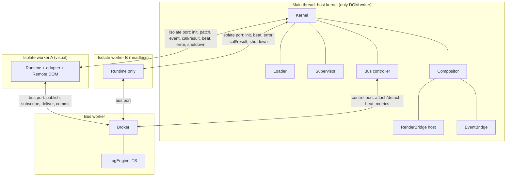
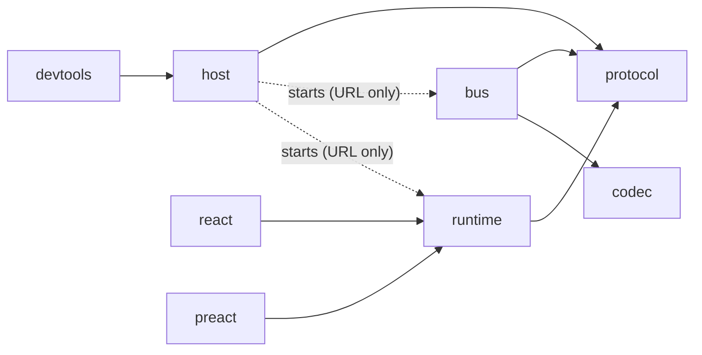
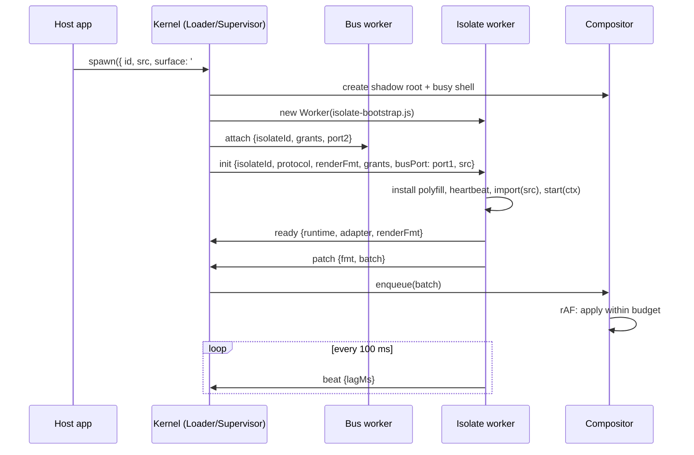
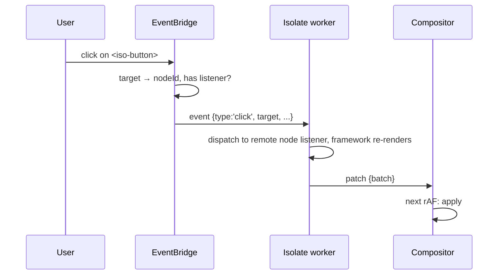
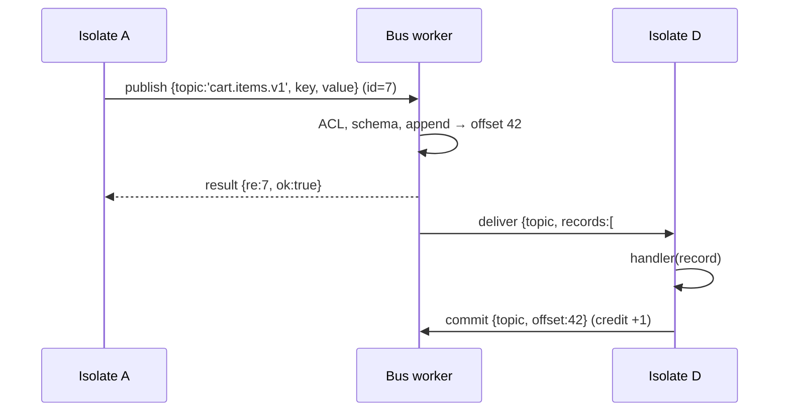
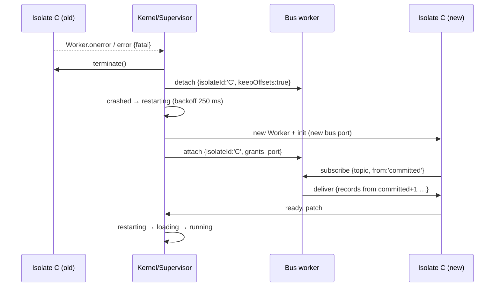
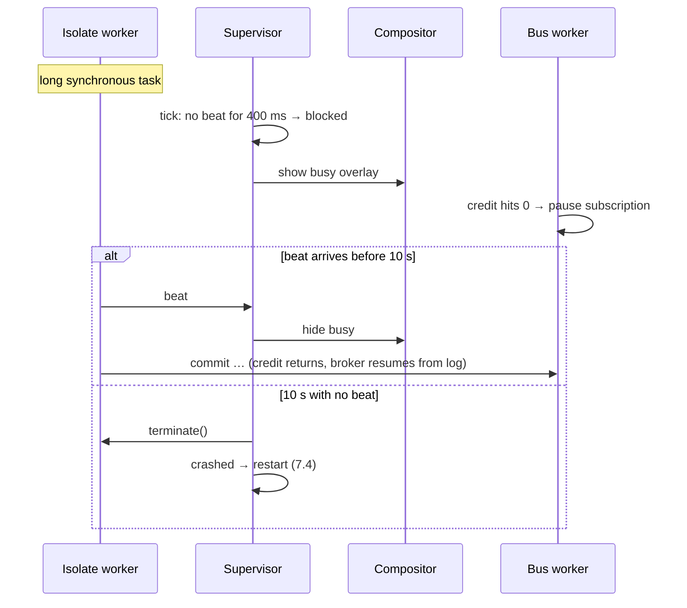
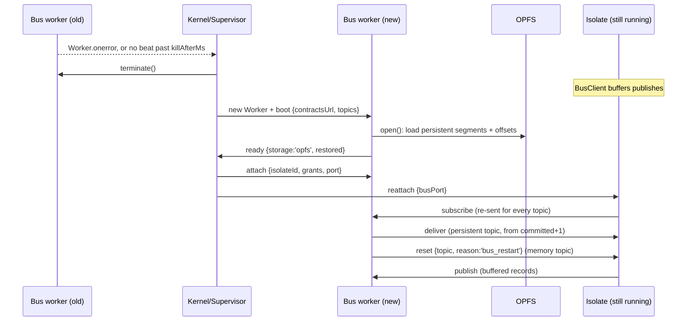

# Isoloop system design

- **Status:** Draft
- **Updated:** 2026-11-03
- **Builds on:** [RFC 0001](../rfcs/0001-threaded-runtime.md) (the *why* and the public shape) and the [ADRs](../adr/README.md) (individual decisions)

This document covers the *how*: runtime topology, package boundaries, the interfaces between modules, the main sequences, and the invariants tests must prove. When it disagrees with RFC 0001, this document wins and the RFC gets a note.

Package names use the `@isoloop/*` scope ([ADR 0004](../adr/0004-npm-name.md)).

**Terms** ([ADR 0008](../adr/0008-isolates-and-surfaces.md)): an *isolate* is the unit of isolation, meaning a code bundle in its own worker. A *visual* isolate has a *surface*, a host DOM element it renders into. A *headless* isolate has none: state stores, sync engines, calculators. Everything in this document applies to both, except the rendering parts (§4.4–4.8), which apply only to visual isolates.

## 1. Runtime topology

Three kinds of thread, and four kinds of channel between them.



| Channel | Ends | Carries | Created by |
| --- | --- | --- | --- |
| Isolate port | main ↔ isolate worker (the `Worker` itself) | `init`, `ready`, `patch`, `event`, `call`/`result`, `beat`, `error`, `shutdown` | Loader |
| Bus port | isolate worker ↔ bus worker (`MessageChannel`) | `publish`, `subscribe`, `unsubscribe`, `deliver`, `commit`, `result` | Bus controller, at each isolate start |
| Control port | main ↔ bus worker (the `Worker` itself) | `attach`, `detach`, `topics`, `beat`, `metrics`, host-side `publish` | Bus controller |
| Canvas handoff | main → isolate worker, once | a transferred `OffscreenCanvas` | Compositor, on request |

**Rule:** no topic record crosses the main thread, except records the host itself publishes or subscribes to through `kernel.publish` / `kernel.subscribe` ([ADR 0005](../adr/0005-bus-topology-message-channels.md)).

## 2. Packages and dependency rules



| Package | Runs in | Depends on | Must not depend on |
| --- | --- | --- | --- |
| `@isoloop/protocol` | everywhere | nothing | anything |
| `@isoloop/codec` (M2b) | bus worker, Node | nothing | DOM types |
| `@isoloop/bus` | bus worker, Node | `protocol`, `codec` (M2b) | DOM types, `host`, `runtime` |
| `@isoloop/host` | main thread | `protocol`, `@remote-dom/core` (host side, inside `RenderBridge` only) | `runtime`, `bus` source (it loads their bundles by URL) |
| `@isoloop/runtime` | isolate worker | `protocol`, `@remote-dom/core` (polyfill, inside `RenderBridge` only) | `host`, `bus` |
| `@isoloop/react`, `@isoloop/preact` | isolate worker | `runtime`, the framework (peer dep) | `host` |
| `@isoloop/devtools` | main thread | `host` | `runtime` |

Enforced with TypeScript project references plus an ESLint `no-restricted-imports` rule per package. `bus` builds with `lib: ["ES2022", "WebWorker"]` minus DOM, so a stray DOM type fails the build; its tests run in Node.

The host ships two prebuilt worker entry bundles, `bus-worker.js` and `isolate-bootstrap.js`. Users serve them from their origin; a Vite plugin (M3) automates this.

## 3. `@isoloop/protocol`

Pure types plus tiny guard functions. Everything else imports message shapes from here.

```ts
export const PROTOCOL = { v: 1, min: 1 } as const;

export type Envelope<T extends string, P> = {
  v: 1;          // protocol version
  t: T;          // message type
  id?: string;   // set when a reply is expected
  re?: string;   // id of the message this replies to
  p: P;
};

// Isolate port: host → isolate
export type HostToIsolate =
  | Envelope<'init', InitPayload>
  | Envelope<'event', SerializedEvent>
  | Envelope<'result', CallResult>
  | Envelope<'shutdown', { reason: ShutdownReason; graceMs: number }>
  | Envelope<'reattach', { busPort: MessagePort }>;             // new bus port after a bus restart (ADR 0007)

// Isolate port: isolate → host
export type IsolateToHost =
  | Envelope<'ready', { runtime: string; adapter: string; renderFmt: string }>
  | Envelope<'patch', { fmt: string; batch: unknown }>
  | Envelope<'call', { method: HostMethod; args: unknown[] }>
  | Envelope<'beat', { lagMs: number; heapBytes?: number }>
  | Envelope<'error', { message: string; stack?: string; fatal: boolean }>;

// Bus port: isolate ↔ bus worker
export type IsolateToBus =
  | Envelope<'publish', { topic: string; key?: string; value: unknown }>   // id set → result
  | Envelope<'subscribe', { topic: string; from: StartPosition; group?: string }>
  | Envelope<'unsubscribe', { topic: string }>
  | Envelope<'commit', { topic: string; offset: number }>;
export type BusToIsolate =
  | Envelope<'deliver', { topic: string; records: BusRecord[]; gap?: { from: number; to: number } }>
  | Envelope<'reset', { topic: string; reason: 'bus_restart' }>    // memory topic lost in a bus restart (ADR 0007)
  | Envelope<'result', CallResult>;

// Control port: host ↔ bus worker
export type HostToBus =
  | Envelope<'boot', { contractsUrl?: string; topics: TopicConfig[] }>
  | Envelope<'attach', { isolateId: string; grants: Grants; port: MessagePort }>
  | Envelope<'detach', { isolateId: string; keepOffsets: boolean }>
  | Envelope<'publish', { topic: string; key?: string; value: unknown }>;
export type BusToHost =
  | Envelope<'ready', { engine: string; storage: 'memory' | 'opfs'; restored: { topic: string; head: number }[] }>
  | Envelope<'beat', { lagMs: number }>
  | Envelope<'metrics', BusMetrics>
  | Envelope<'error', { message: string; stack?: string; fatal: boolean }>;

export type InitPayload = {
  isolateId: string;
  protocol: { min: number; max: number };
  renderFmt: string;              // 'remote-dom@1', 'legacy-vdom@1', or 'none' (headless)
  config: unknown;                // manifest.config, passed through
  grants: Grants;
  busPort: MessagePort;           // transferred
  heartbeatMs: number;
  src: string;                    // isolate module URL, imported by the bootstrap
};

export type BusRecord = { offset: number; key?: string; value: unknown; ts: number; producer: string };
export type StartPosition = 'latest' | 'earliest' | 'committed';
export type Grants = { publish: string[]; subscribe: string[] };
export type HostMethod = 'measure' | 'focus' | 'navigate' | 'scrollIntoView' | 'requestCanvas';
export type CallResult = { ok: true; value: unknown } | { ok: false; error: { code: string; message: string } };
```

`init` / `ready` are the version handshake. The host sends its supported range. The isolate replies with the runtime version and render format it actually uses, or posts `error { fatal: true, code: 'protocol_mismatch' }`. Each side drops (and counts) envelopes with an unknown `v` or `t`, so old isolates don't crash on new message types.

The package also exports `isEnvelope`, `assertNever`, the error-code enum, and the `Grants` matcher (topic globs like `catalog.*`).

## 4. `@isoloop/host`

### 4.1 Kernel

The public façade and wiring point. It owns no logic of its own beyond configuration and the event emitter.

```ts
createKernel(config: KernelConfig): Kernel

type KernelConfig = {
  topics: TopicDef[];
  contracts?: string;                       // ES module URL, imported by the bus worker (ADR 0003)
  components?: Record<string, HostComponent>;
  supervisor?: { strategy: 'one-for-one' | 'never'; maxRestarts: number; withinMs: number; backoff?: Backoff };
  heartbeat?: { everyMs: number; blockedAfterMs: number; killAfterMs: number; readyTimeoutMs: number };
  compositor?: { frameBudgetMs: number };
  workers?: { bus: string; isolateBootstrap: string };   // URLs of the shipped worker bundles
  onNavigate?: (req: NavigateRequest) => boolean | Promise<boolean>;
};

interface Kernel {
  spawn(manifest: IsolateManifest): IsolateHandle;     // manifest.surface optional (ADR 0008)
  stop(id: string): Promise<void>;
  restart(id: string): Promise<void>;
  publish<T>(topic: TopicDef<T>, rec: { key?: string; value: T }): Promise<void>;
  subscribe<T>(topic: TopicDef<T>, fn: (r: BusRecord) => void, opts?: { from?: StartPosition }): () => void;
  on(event: KernelEvent, fn: (e: any) => void): () => void;   // isolate:state, isolate:crash, isolate:failed, bus:crash, ...
  isolates(): IsolateSnapshot[];                                      // used by devtools
  destroy(): Promise<void>;
}
```

Defaults: heartbeat `100 / 400 / 10_000` ms, ready timeout `10_000` ms, frame budget `8` ms, supervisor `one-for-one`, 3 restarts in 60 s, backoff `250 ms × 2ⁿ` capped at 4 s.

### 4.2 Loader

Turns a manifest into a running worker.

1. Resolve `src`. A URL is used as is. A Module Federation remote (`mf:<remote>/<expose>`) is resolved through a pluggable `resolveRemote` hook (M3+).
2. Create `new Worker(isolateBootstrap, { type: 'module', name: isolateId })`. Workers must be same-origin, so isolate code is never the worker script itself. The bootstrap `import()`s the isolate module at `init.src`. That works cross-origin when the isolate CDN sends CORS headers.
3. Ask the bus controller for a bus port, then post `init` with the bus port transferred.
4. Hand the worker to the supervisor (state `Loading`).

CSP needs: `worker-src 'self'`, `script-src` allowing the isolate CDN (for `import()` inside the worker), and `connect-src` to match. The docs list these.

The PoC prepended the runtime string to a blob, which needs `worker-src blob:` and doesn't support cross-origin ES modules. The bootstrap approach replaces it at M1.

### 4.3 Supervisor

A pure state machine per isolate plus timers, separated so it can be unit-tested with fake clocks:

```ts
type IsolateState = 'loading' | 'running' | 'blocked' | 'stopped' | 'crashed' | 'restarting' | 'failed';
type SupervisorInput =
  | { k: 'ready' } | { k: 'beat'; at: number; lagMs: number } | { k: 'tick'; at: number }
  | { k: 'error'; fatal: boolean; message: string } | { k: 'workerError'; message: string }
  | { k: 'stop' } | { k: 'respawn' };
type SupervisorEffect =
  | { k: 'terminate' } | { k: 'spawn'; afterMs: number } | { k: 'showBusy' | 'hideBusy' }
  | { k: 'showFallback'; reason: string } | { k: 'emit'; event: KernelEvent; data: unknown };

function step(s: IsolateSupervision, input: SupervisorInput): { s: IsolateSupervision; effects: SupervisorEffect[] };
```

Transitions (matching the RFC lifecycle diagram):

| From | Input | To | Effects |
| --- | --- | --- | --- |
| loading | `ready` | running | emit `isolate:ready` |
| loading | tick past `readyTimeoutMs` | crashed | terminate |
| running | tick, no beat for `blockedAfterMs` | blocked | showBusy |
| blocked | `beat` | running | hideBusy |
| blocked | tick, no beat for `killAfterMs` | crashed | terminate |
| running / blocked | `workerError` or fatal `error` | crashed | terminate, emit `isolate:crash` |
| crashed | restarts in window < max | restarting | spawn after backoff |
| crashed | restarts in window ≥ max, or strategy `never` | failed | showFallback, emit `isolate:failed` |
| restarting | (spawned) | loading | – |
| any but failed | `stop` | stopped | `shutdown` with grace, then terminate |
| failed / stopped | `respawn` | loading | resets restart window |

Non-fatal `error` messages (a caught exception in a handler) are only reported (`isolate:error`). They don't change state.

The supervisor also tracks the bus worker. A bus crash doesn't restart isolates: they get a new bus port (`reattach`) and keep running ([ADR 0007](../adr/0007-bus-worker-supervision.md), §7.7).

### 4.4 Compositor

Owns every surface in the DOM and is the **only** code that writes to it.

- When an isolate with a `surface` spawns, it creates `<iso-surface data-isolate-id>` in that target. That element is the shadow host; the shadow root holds the isolate's adopted stylesheets, a busy overlay and a fallback slot. Headless isolates get no surface and never reach the compositor.
- Each isolate has a FIFO of `PatchBatch`es. `patch` messages enqueue and schedule one `requestAnimationFrame`.
- **Per frame:** start at a rotating isolate index (round-robin fairness), apply whole batches while `performance.now() - frameStart < frameBudgetMs`, and always apply at least one batch per frame so progress is guaranteed. Batches left over roll to the next frame. Batches are never split, since a batch is one atomic UI state.
- Exposes `stats()` per isolate (queue depth, ms applied per frame, batches dropped on stop) for devtools and metrics.
- On restart it clears the isolate's queue and its shadow content, then keeps the shell (busy/fallback UI) in place.

### 4.5 RenderBridge (host side)

The only module that imports Remote DOM on the main thread ([ADR 0006](../adr/0006-render-bridge-over-remote-dom.md)).

```ts
interface HostRenderBridge {
  readonly fmt: string;                                    // 'remote-dom@1' | 'legacy-vdom@1'
  mount(root: ShadowRoot, registry: ComponentRegistry): void;
  apply(batch: unknown): void;                             // called only by the Compositor
  idFor(node: Node): string | undefined;                   // for the EventBridge
  nodeFor(id: string): Element | undefined;                // for measure/focus
  unmount(): void;
}
```

**Component registry.** An allow-list of safe HTML tags (the PoC's list plus `a`, `img`, `table` family, `form` family, `svg` subset), plus host components (`iso-button` → design-system element) registered through `KernelConfig.components`. Unknown tags render as `div`. `script`, `iframe`, `object`, `embed`, `style` and `on*` attributes are never created. `href`/`src` are restricted to `http(s):`, `mailto:` and relative URLs.

### 4.6 EventBridge and inputs

- One listener per event type on each shadow root, for a fixed set: `click`, `dblclick`, `input`, `change`, `keydown`, `keyup`, `submit`, `focusin`, `focusout`, `pointerdown`, `pointerup`. Pointer moves are opt-in per node and throttled to one per frame.
- An event fires only if the isolate registered a listener for `(nodeId, type)` on the target or an ancestor. Those registrations travel in patches.
- Serialized event: `{ type, target: nodeId, currentTargets: nodeId[], value?, checked?, key?, code?, mods, x?, y?, button? }`.
- **Default actions:** `submit` and same-origin `<a>` clicks are always prevented on the host; links become `navigate` ([ADR 0002](../adr/0002-host-owns-routing.md)). Other defaults run normally. An isolate can't call `preventDefault` synchronously, so the docs list this limit.
- **Host-owned inputs:** `input`, `textarea` and `select` keep their own value and caret on the host. The isolate gets `input` events with the value. A `value` from the isolate is applied only if it differs from the live value and the element isn't focused, or the isolate sets `force`. That avoids caret jumps and the per-keystroke round trip.

### 4.7 Host calls

`call` → `result`, with a 5 s default timeout on the isolate side.

| Method | Behaviour |
| --- | --- |
| `measure(nodeId)` | `getBoundingClientRect` relative to the surface, read in the next rAF after pending patches apply |
| `focus(nodeId)` / `scrollIntoView(nodeId, opts)` | Applied after pending patches |
| `navigate({ href, replace })` | Goes through `onNavigate`; result is `true`/`false` |
| `requestCanvas(nodeId, { width, height })` | Host takes a `<canvas>` it rendered for that node, calls `transferControlToOffscreen()`, and returns the `OffscreenCanvas` as a transferable. Resizes arrive later as `event { type: 'resize' }` |

### 4.8 Styles

An isolate sends stylesheet text in a patch-side side channel (`styles: string[]`). The compositor turns each into a `CSSStyleSheet` and assigns it to `shadowRoot.adoptedStyleSheets`. Host design tokens pass through CSS custom properties, which inherit through the shadow boundary.

## 5. `@isoloop/runtime`

The runtime that runs inside each isolate worker.

- **Bootstrap** (`isolate-bootstrap.js`): waits for `init`, checks the protocol range, sets up the RenderBridge polyfill if the isolate has a surface (installs the Remote DOM `window`/`document` shim; skipped when `renderFmt` is `'none'`), starts the heartbeat, connects the bus port, then `await import(init.src)`. The isolate module's default export is an `IsolateDefinition`, and the bootstrap calls `definition.start(ctx)`.
- **Heartbeat:** `setInterval(everyMs)`. `lagMs = max(0, now - last - everyMs)`. Adds `performance.memory.usedJSHeapSize` where available.
- **Errors:** `self.onerror` and `onunhandledrejection` post `error { fatal: false }`. A throw during `start` is fatal. The host also catches `Worker.onerror` for errors the runtime can't see.
- **IsolateContext** (what adapters build on):

```ts
interface IsolateContext {
  id: string;
  config: unknown;
  root?: RemoteRootElement;                        // render target (Remote DOM); undefined when headless
  bus: BusClient;
  host: { measure(id: string): Promise<Rect>; focus(id: string): Promise<void>;
          navigate(href: string, o?: { replace?: boolean }): Promise<boolean>;
          requestCanvas(el: Element, size: Size): Promise<OffscreenCanvas> };
  styles(css: string | string[]): void;
  onShutdown(fn: (reason: ShutdownReason) => void | Promise<void>): void;
}

interface BusClient {
  publish<T>(topic: TopicDef<T>, rec: { key?: string; value: T }): Promise<void>;   // rejects on schema/ACL error
  subscribe<T>(topic: TopicDef<T>, fn: (r: TypedRecord<T>) => void | Promise<void>,
               opts?: { from?: StartPosition; group?: string; autoCommit?: boolean }): () => void;
  request<Req, Res>(topic: TopicDef<Req>, value: Req, opts?: { timeoutMs?: number }): Promise<Res>;
}
```

`subscribe` with `autoCommit` (default `true`) commits the record's offset after the handler's promise resolves. That gives at-least-once delivery, so handlers must be idempotent (stated in the docs).

`defineIsolate(fn)` in each adapter wraps a framework component into an `IsolateDefinition`. Vanilla and headless isolates export `{ start(ctx) {} }` directly.

**Headless isolates** ([ADR 0008](../adr/0008-isolates-and-surfaces.md)) get the same bootstrap, heartbeat, error handling and `BusClient`, but no polyfill and no `root`. `styles()` is a no-op, and the DOM host calls reject with `no_surface`. A typical headless isolate is a store: it subscribes to command topics, keeps state, and publishes snapshots to a compacted topic that visual isolates read with `from: 'earliest'`.

## 6. `@isoloop/bus`

No DOM, so it's testable in Node. The bus worker entry (`bus-worker.js`) is a thin shell that wires ports to a `Broker`.

### 6.1 Topics and records

```ts
type TopicDef<T> = {
  name: string;                                  // 'cart.items.v1'
  schema?: StandardSchemaV1<T>;
  retention: { kind: 'last-n'; n: number } | { kind: 'time'; ms: number } | { kind: 'compacted' };
  maxRecordBytes?: number;                       // default 256 KiB, rough estimate by structured size
  durability?: 'memory' | 'persistent';          // default 'memory'; 'persistent' = OPFS (ADR 0007, M2b)
};
function topic<T>(name: string, def: Omit<TopicDef<T>, 'name'>): TopicDef<T>;
```

`TopicDef` objects are what host, isolates and the bus worker share through the contracts module ([ADR 0003](../adr/0003-schema-format-standard-schema.md)). On the wire only the name travels.

### 6.2 LogEngine interface

```ts
interface LogEngine {
  createTopic(cfg: TopicConfig): void;
  append(topic: string, rec: Omit<BusRecord, 'offset'>): number;         // returns offset
  read(topic: string, fromOffset: number, max: number): BusRecord[];     // offsets ascending, may skip compacted/expired
  head(topic: string): number;                                           // next offset to be written
  tail(topic: string): number;                                           // oldest retained offset
  commit(topic: string, consumer: string, offset: number): void;
  committed(topic: string, consumer: string): number | undefined;
  compact(topic: string): void;                                          // retention pass
}
```

The TS engine stores each topic as a chunked array plus, for compacted topics, a `Map<key, offset>`. Retention runs on append (`last-n`), on a 1 s timer (`time`), and at a dirty-ratio threshold (`compacted`). Offsets are monotonic per topic and never reused. The M5 WASM engine implements the same interface, and a shared conformance test suite runs against both.

**Storage under the engine** ([ADR 0007](../adr/0007-bus-worker-supervision.md)). The engine writes through a `LogStorage` for topics with `durability: 'persistent'`:

```ts
interface LogStorage {
  open(): Promise<StoredState>;                                   // segments + offsets found on disk
  appendBatch(topic: string, encoded: Uint8Array[]): void;        // buffered; group commit every 5 ms / 256 records
  flush(): Promise<void>;                                         // resolves when the batch is durable → publish acked
  saveOffsets(offsets: Record<string, Record<string, number>>): void;
  rewrite(topic: string, keep: (offset: number) => boolean): Promise<void>;   // retention/compaction on disk
  readSegment(topic: string, fromOffset: number): Promise<Uint8Array[]>;      // replay of evicted segments
  quarantineNewest(): Promise<string[]>;                          // safe mode
}
```

`MemoryStorage` (M2) is a no-op. `OpfsStorage` (M2b) keeps one directory per topic, segment files of up to 4 MiB, and an offsets file, all accessed through sync access handles inside the bus worker, under a Web Lock so only one tab writes. Records are encoded by a shared binary codec (`@isoloop/codec`, also used by M5).

### 6.3 Broker

Responsibilities, in order, for a `publish`:

1. **ACL:** the topic must match `grants.publish` for this isolate, or the result is error `forbidden`.
2. **Topic exists**, or error `unknown_topic`.
3. **Size** check, or error `too_large`.
4. **Schema:** `schema['~standard'].validate(value)`, or error `invalid` with the issues.
5. `engine.append`, with `producer = isolateId` and `ts = Date.now()`.
6. Reply `result { ok }` if the publish had an `id`.
7. **Fan out:** push to each live subscription.

**Subscriptions and consumers.** The consumer id is `isolateId` (or `group` for groups). Offsets are kept by the engine keyed by consumer id, so they survive isolate restarts. On `subscribe`, the start offset is `latest` → `head`, `earliest` → `tail`, or `committed` → `committed + 1`, falling back to `earliest`.

**Groups.** Subscribers sharing a `group` get each record once among them, by hash of key (records with no key go round-robin). That keeps per-key order within a group.

**Delivery and backpressure (credits).** Each subscription has `credit`, starting at the inbox limit (default 1,000). The broker pushes `deliver` batches (up to 64 records, coalesced per microtask) while `credit > 0`, and subtracts the number sent. A `commit` restores credit for the committed records. At 0 credit the subscription is *paused*: nothing is queued in memory, only its read cursor is kept. When credit comes back, the broker reads from the log at the cursor. Records that expired while paused are skipped, and the isolate gets a `deliver` with `gap: { from, to }` so it can tell.

**Request/response.** `bus.request(topic, value)` publishes with a reserved `replyTo` (the caller's isolate id) and a correlation id in the record. Responders call `reply(record, value)`, which the broker sends straight to the caller's port as `result { re }`, not through a log. Timeout errors are raised on the caller side.

**Metrics** (sampled every 1 s on the control port): records/s per topic, bytes/s, per-subscription lag (`head − cursor`) and credit, rejected publishes by reason.

## 7. Key sequences

### 7.1 Spawn → first paint



### 7.2 Click → event → patch → paint



Click-to-paint is measured from the host `pointerdown` timestamp to the rAF in which the resulting batch applies (bench `click-to-paint`).

### 7.3 Publish → validate → deliver → commit



A rejected publish returns `result { ok: false, error: { code: 'invalid' } }`. Isolate A's `publish()` promise rejects and nothing is appended.

### 7.4 Crash → restart → replay



### 7.5 Blocked → recovered or killed



### 7.6 Shutdown

`kernel.stop(id)` → `shutdown { reason: 'stop', graceMs: 1000 }`. The isolate runs its `onShutdown` handlers, then commits offsets. The kernel calls `terminate()` after the grace period or on the isolate's last message, sends `detach`, and the compositor removes the surface. The isolate ends in state `stopped`.

### 7.7 Bus worker crash

Isolates keep running; only their bus connection is replaced ([ADR 0007](../adr/0007-bus-worker-supervision.md)).



An isolate with `bus: { onReset: 'restart' }` is restarted instead of receiving `reset`. If the new bus crashes again while loading, safe mode sets the newest segments aside and the kernel emits `bus:recovered`.

## 8. Invariants

Each invariant has at least one automated test (unit **U**, browser **B**, Playwright **E2E**).

| # | Invariant | Test |
| --- | --- | --- |
| I1 | Only the compositor writes to the DOM under a surface | E2E: `MutationObserver` on the roots records only compositor-flushed changes; lint rule forbids DOM writes elsewhere |
| I2 | A blocked isolate doesn't delay other isolates' paints by more than one frame | E2E: block C 3 s, B's clock keeps updating, main fps ≥ 55 |
| I3 | A crashed isolate doesn't affect others and restarts under its limit | E2E + U (supervisor table tests) |
| I4 | An isolate can only publish/receive granted topics | U (broker) + E2E (isolate attempts forbidden publish) |
| I5 | Order is kept per topic and per key; offsets are monotonic | U, plus property-based tests on the engine |
| I6 | A restarted isolate with `from: 'committed'` sees every record after its last commit, once retained | U + E2E replay test (M2 done-criterion) |
| I7 | No topic record crosses the main thread | B: instrument main-thread `postMessage`/`onmessage` and assert no `deliver`/`publish` from isolates |
| I8 | A frame applies at least one batch, and no more than budget + one batch | U (compositor with fake clock) |
| I9 | Unknown tags render as `div`; `script`/`iframe`/`on*` never appear | U (registry) + E2E |
| I10 | Protocol mismatch fails at `init` with a clear error, never mid-render | U |
| I11 | A bus restart never restarts an isolate (unless it opted in); every subscription to a memory topic gets exactly one `reset` | B + E2E (M2) |
| I12 | A persistent topic loses no acknowledged record across a bus crash or a page reload | U (storage fault injection) + E2E (M2b) |

## 9. Performance budgets

Starting targets, to be calibrated in M1/M2 benches and then enforced in CI with a tolerance.

| Metric | Target | Bench |
| --- | --- | --- |
| Click-to-paint overhead vs. the same UI single-threaded | p95 ≤ 8 ms (one frame budget) | `bench/click-to-paint` |
| Compositor DOM work per frame | ≤ 8 ms (default budget) | compositor stats |
| Heartbeat-detected blocking | ≤ 500 ms to show busy | E2E |
| Idle isolate memory, vanilla / Preact / React | ≤ 3 / 5 / 12 MB (measure first) | `bench/memory-per-isolate` |
| Bus throughput, TS engine, 10 subscribers, 200-byte records | ≥ 50k records/s delivered | `bench/throughput` |
| Restart to first paint (no replay) | ≤ 300 ms after backoff | E2E timing |

## 10. Testing strategy

- **Unit (Vitest, Node):** `protocol` guards, `bus` (broker, engine conformance suite, retention, credits, groups), supervisor `step()` tables, compositor scheduling with a fake rAF and clock, registry sanitising.
- **Browser (Vitest browser mode, Chromium):** isolate runtime in a real worker, RenderBridge round-trip, EventBridge serialisation, host calls.
- **E2E (Playwright, Chromium + Firefox + WebKit):** against `examples/four-loops` and, from M3, `examples/dashboard`. Isolation (I2, I3), ACL (I4), replay (I6), input latency smoke checks.
- **Bench (`bench/`):** run in CI on Chromium. Results are stored as artifacts and compared with the main-branch baseline. Fail on more than 20% regression.

## 11. Security posture

- Workers are same-origin with the host, which isn't a security boundary. An isolate can `fetch` with the host origin's cookies and can read `IndexedDB` for that origin. v1 targets *trusted-but-unreliable* code (other teams, AI-generated widgets you review), not hostile code.
- What v1 does guarantee: no direct DOM access, sanitised rendering (registry), topic ACLs, and schema validation.
- Hostile code needs the later **iframe tier**: a cross-origin sandboxed iframe that hosts the isolate worker and forwards the same protocol. The protocol is designed to be relayable for this (copyable envelopes; ports transferable through `postMessage`).

## 12. Traceability

| RFC 0001 goal or item | Where it's designed | Milestone |
| --- | --- | --- |
| Thread isolation | §1, §4.2, ADR 0001 | M1 |
| Single-writer rendering | §4.4–4.6, ADR 0006 | M1 |
| Messages as the only contract | §3, §6.1, ADR 0003 | M0–M2 |
| Durable, replayable bus | §6, §7.3–7.4, ADR 0005 | M2 |
| Supervision | §4.3, §7.4–7.5, §7.7, ADR 0007 | M1 (isolates), M2 (bus) |
| Persistence | §6.2 `LogStorage`, ADR 0007 | M2b |
| Framework-agnostic isolates | §5, adapters | M3 |
| Parallel canvas charts | §4.7 `requestCanvas` | M3 |
| Routing | ADR 0002 | M3 |
| Devtools | §6.3 metrics, `Kernel.isolates()`, compositor stats | M4 |
| Shared-memory engine | §6.2 `LogEngine` | M5 |

Every wire message in RFC 0001 appears in §7: `init`, `ready`, `patch`, `event`, `beat` (7.1–7.2); `publish`, `deliver`, `commit`, `result` (7.3); `subscribe`, `error` (7.4); `call`/`result` (§4.7); `unsubscribe` and `shutdown` (7.6).
