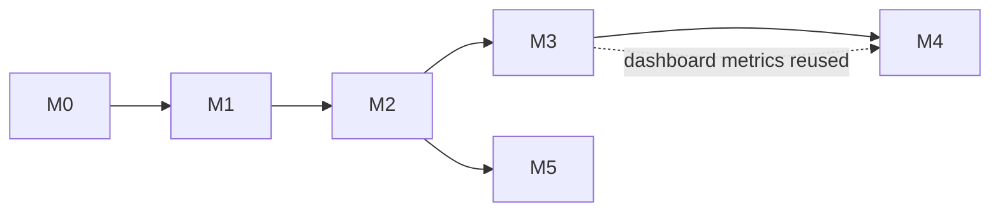

# Implementation plans

One plan per milestone of [RFC 0001](../rfcs/0001-threaded-runtime.md#mvp-roadmap-and-repo-structure), built on the [system design](../design/system-design.md).

| Milestone | Plan | Detail | Done when |
| --- | --- | --- | --- |
| M0 Foundations | [m0-foundations.md](m0-foundations.md) | Full | The four-loops demo runs from the repo and CI is green |
| M1 Kernel | [m1-kernel.md](m1-kernel.md) | Full | A blocked or crashed isolate never affects the others, proven by Playwright tests |
| M2 Bus | [m2-bus.md](m2-bus.md) | Full | A restarted isolate rebuilds its state from the log in a test |
| M3 Adapters + dashboard | [m3-adapters-dashboard.md](m3-adapters-dashboard.md) | Outline | Dashboard live on a public URL; recorded comparison in the README |
| M4 Devtools + 0.1 | [m4-devtools-release.md](m4-devtools-release.md) | Outline | `0.1.0` on npm with a launch post |
| M5 Shared-memory engine | [m5-shared-memory-engine.md](m5-shared-memory-engine.md) | Outline | Benchmark results published, whichever engine wins |

Outlines get full task lists when the milestone before them closes, so they reflect what was learned.

M1 and M2 can overlap: `packages/bus` is pure TypeScript with no browser dependency, so M2 tasks 1–6 can start any time after M0.

## Conventions

- **Task size:** about one evening (2–3 h). If a task grows past two evenings, split it.
- **Every task names its files and its tests.** A task is done when its tests pass in CI.
- **Each milestone ends with a demo and a write-up** (a short post or README section). That's the RFC's rule: each milestone ends in something that can be demoed, released and written about.
- **Branches:** `m<N>/<task-slug>`, squash-merged to `main`. Changesets record user-facing changes from M1 on.
- **Decisions** made during a milestone become ADRs in [`docs/adr`](../adr/README.md).
