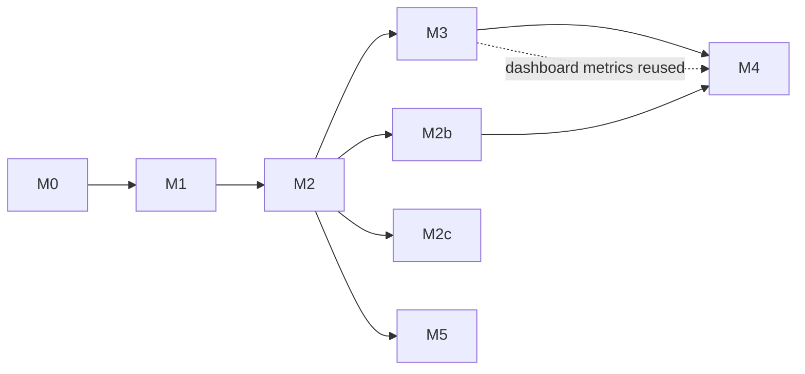

# Implementation plans

One plan per milestone of [RFC 0001](../rfcs/0001-threaded-runtime.md#mvp-roadmap-and-repo-structure), built on the [system design](../design/system-design.md).

| Milestone | Plan | Detail | Done when |
| --- | --- | --- | --- |
| M0 Foundations | [m0-foundations.md](m0-foundations.md) | Full | The four-loops demo runs from the repo and CI is green |
| M1 Kernel | [m1-kernel.md](m1-kernel.md) | Full | A blocked or crashed isolate never affects the others, proven by Playwright tests |
| M2 Bus | [m2-bus.md](m2-bus.md) | Full | A restarted isolate rebuilds its state from the log in a test |
| M2b Durable log | [m2b-durable-log.md](m2b-durable-log.md) | Outline | A persistent topic loses no acknowledged record across a bus crash or a page reload |
| M2c Worker pools | [m2c-worker-pools.md](m2c-worker-pools.md) | Outline | Pooled and own-worker isolates run side by side; a pool crash restarts only that pool |
| M3 Adapters + dashboard | [m3-adapters-dashboard.md](m3-adapters-dashboard.md) | Outline | Dashboard live on a public URL; recorded comparison in the README |
| M4 Devtools + 0.1 | [m4-devtools-release.md](m4-devtools-release.md) | Outline | `0.1.0` on npm with a launch post |
| M5 Shared-memory engine | [m5-shared-memory-engine.md](m5-shared-memory-engine.md) | Outline | Benchmark results published, whichever engine wins |

Outlines get full task lists when the milestone before them closes, so they reflect what was learned.

M1 and M2 can overlap: `packages/bus` is pure TypeScript with no browser dependency, so M2 tasks 1–6 can start any time after M0.

## Conventions

- **Task size:** about one evening (2–3 h). If a task grows past two evenings, split it.
- **Every task names its files and its tests.** A task is done when its tests pass in CI.
- **Each milestone ends with a demo and a write-up** (a short post or README section). That's the RFC's rule: each milestone ends in something that can be demoed, released and written about.
- **Branches:** `<type>/<slug>`, squash-merged to `main`. Types: `feature/` (new behaviour), `fix/` (a bug), `chore/` (tooling, deps, CI, refactors with no behaviour change), `docs/` (docs only). Milestone tasks put the milestone first in the slug, e.g. `feature/m0-workspace-skeleton`. The squash commit uses the matching conventional prefix (`feat:`, `fix:`, `chore:`, `docs:`). Changesets record user-facing changes from M1 on.
- **Merging:** every change, docs included, reaches `main` through a PR that is squash-merged on GitHub (`gh pr merge --squash`). A ruleset on `main` enforces this: PR required, squash only, linear history, no force-push or deletion. The PR title becomes the squash commit title, so it carries the conventional prefix. From M0 task 9 on, CI must be green before merging.
- **Decisions** made during a milestone become ADRs in [`docs/adr`](../adr/README.md).
- **Deferred ideas** live in [`docs/would-like.md`](../would-like.md), not in a plan, until a milestone takes them on.
- **Committed work that waits on something** (a package, a milestone) lives in [`docs/should-do.md`](../should-do.md), with what it waits on and its target milestone. It moves into a plan when that lands.
