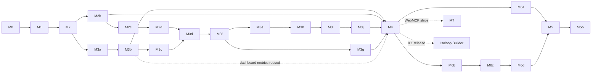

# Implementation plans

One plan per milestone of [RFC 0001](../rfcs/0001-threaded-runtime.md#mvp-roadmap-and-repo-structure), built on the [system design](../design/system-design.md).

| Milestone | Plan | Detail | Status | Done when |
| --- | --- | --- | --- | --- |
| M0 Foundations | [m0-foundations.md](m0-foundations.md) | Full | Done | The four-loops demo runs from the repo and CI is green |
| M1 Kernel | [m1-kernel.md](m1-kernel.md) | Full | Done | A blocked or crashed isolate never affects the others, proven by Playwright tests |
| M2 Bus | [m2-bus.md](m2-bus.md) | Full | Done | A restarted isolate rebuilds its state from the log in a test |
| M2b Durable log | [m2b-durable-log.md](m2b-durable-log.md) | Full | Done | A persistent topic loses no acknowledged record across a bus crash or a page reload |
| M2c Worker pools (headless) | [m2c-worker-pools.md](m2c-worker-pools.md) | Full | Done (2026-11-09) | Pooled and own-worker isolates run side by side; a pool crash restarts only that pool |
| M2d Visual pools | [m2d-visual-pools.md](m2d-visual-pools.md) | Full | Done (2026-11-14, with `plant-v0.1.0`) | The plant dashboard ships with 72 widgets in 9 visual pools |
| M3 Adapters + dashboard (initiative) | [m3-adapters-dashboard.md](m3-adapters-dashboard.md) | Overview | Done (2026-11-15, with `markets-v0.3.0`): M3a–M3d and M3f | Dashboard live on a public URL; recorded comparison in the README |
| ↳ M3a Adapters (epic) | [m3a-adapters.md](m3a-adapters.md) | Full | Done | Both adapters pass the adapter conformance suite on every supported major |
| ↳ M3b Dashboard (epic) | [m3b-dashboard.md](m3b-dashboard.md) | Full | Done (live since `markets-v0.1.0`) | The M3 done-when |
| ↳ M3c Dashboard sizes (epic) | [m3c-dashboard-sizes.md](m3c-dashboard-sizes.md) | Full | Done (`markets-v0.2.0`) | Lite, Normal and Heavy sizes on every build; the comparison across sizes recorded, whatever it shows |
| ↳ M3d Plant dashboard (epic) | [m3d-plant-dashboard.md](m3d-plant-dashboard.md) | Full | Done (`plant-v0.1.0`, 2026-11-14) | 72-widget plant dashboard on three builds and six placements: what the whole package costs against matched native builds, and what it gives |
| ↳ M3f Markets parity (epic) | [m3f-markets-parity.md](m3f-markets-parity.md) | Full | Done (`markets-v0.3.0`, 2026-11-15) | Markets runs a native + workers build and `own`, `one` and `matched` placements, measured in matched pairs on the bench server and written up; ships as `markets-v0.3.0`, after which the website shows markets figures again |
| M3e Live widget creator (epic) | [m3e-live-widget-creator.md](m3e-live-widget-creator.md) | Full | Done (`plant-v0.2.0`, 2026-11-17; markets' page in `markets-v0.4.0`) | Plant and markets each get an interactive page, opened from their header, with 4–8 starter widgets you can edit or delete and an Add drawer that creates new ones from the dashboard's topics (a JSON spec: source → filter/window/aggregate → one of five views, no user code), each widget an isolate placed manually in an existing pool or a new one; on plant at `?rate=5` both directions (drawer → dashboard, dashboard → drawer) measured against native and written up; ships as `plant-v0.2.0`, then `markets-v0.4.0` |
| M3h Auto placement (epic) | [m3h-auto-placement.md](m3h-auto-placement.md) | Full | Done (`processor-v0.1.0`, 2026-11-17; write-up web#133). plant's interactive page places `auto` widgets since `plant-v0.2.0`, and markets' since `markets-v0.6.0` | An `@experimental` `@isoloop/balancer` package, under ADR 0017, places `auto` widgets on the interactive pages from each member's measured `busyMs` (a new public signal): a widget that spikes or crashes goes to a quarantine pool until it's steady, a steadily heavy one moves to a pool with room, one that gets its pool killed is found by bisecting; tested on a simulated kernel and with `?chaos` on plant; a new `apps/processor` example (a Playground of tasks with CPU sliders, then a synthetic File processor) is its main demo, and the File processor is measured against `one` and `own` on the bench server, whatever it shows |
| M3i Balancer scaling (epic) | [m3i-balancer-scaling.md](m3i-balancer-scaling.md) | Full | Done (`processor-v0.2.0`, 2026-11-17; measured in web#149, write-up web#150) | `@isoloop/balancer` moves an isolate whose app-reported backlog grows, packs steady members back to free a worker, moves only when a move is predicted to help (at most 3 per isolate in 5 minutes), and quarantines on a second spike within 60 s; shown on the processor's Playground, and the File processor measured again on the bench server, whatever it shows |
| M3j Balancer gaps (epic) | [m3j-balancer-gaps.md](m3j-balancer-gaps.md) | Full | Done (`processor-v0.3.0`, 2026-11-20): on `0.1.0-next.6`, the File processor lost no file in 26 balancer runs (write-up web#200, published web#201); fixes found by its runs shipped in `0.1.0-next.3` to `next.6` | `@isoloop/balancer` takes an app-reported `busyMs` for work its busy time misses, packs quiet members back while their backlog holds steady, lets offenders out of the quarantine within 2 minutes, bisects only with a quarantine pool of its own, and never places or revives an isolate the kernel gave up on (`failed`); shown on the processor's Playground, and the File processor measured again on `0.1.0-next.N` with no file left without a result, whatever else it shows |
| M3g Federated comparison (epic) | [m3g-federated-comparison.md](m3g-federated-comparison.md) | Full | Done (`markets-v0.5.0`, 2026-11-16) | Markets runs a `native-mixed` build (native + workers, with the Preact part built and shipped apart and loaded at run time by `import()` from its own manifest, no Module Federation plugin) and a `teams` placement on `mixed` (a pool per team); `native-mixed` against `mixed` in `matched`, with `teams` and `own` alongside, measured on the bench server with the M3f method (JS bytes, memory and start-up with two runtimes, and what blocking or crashing the Preact team's alerts panel takes down) and written up; the site's "many teams" use links to it; ships as `markets-v0.5.0` |
| Website (in `isoloop/web`) | [site.md](https://github.com/isoloop/web/blob/main/docs/plans/site.md) | Full | Done (`site-v0.1.0`, 2026-11-14) | `isoloop.dev` serves the landing page, how it works and the examples hub, with basic embedded live (`site-v0.1.0`); decisions in `isoloop/web` [ADRs 0001–0003](https://github.com/isoloop/web/tree/main/docs/adr) |
| M4 Devtools, agents + 0.1 (initiative) | [m4-devtools-release.md](m4-devtools-release.md) | Overview | In progress: M4a and M4b built (2026-11-17 to 19); the API frozen in `0.1.0-next.9` and the docs live with the API reference on `0.1.0-next.10` (2026-11-21). Left: M4a's skill and real-agent run, then `0.1.0` after the maintainer's landing-page pass. Split into four epics on 2026-11-17 | `0.1.0` on npm with a launch post, and each epic's done-when met |
| ↳ M4a Agents (epic) | [m4a-agents.md](m4a-agents.md) | Full | In progress (grilled 2026-11-17; ADR 0018 accepted, amended 2026-11-19 for Firefox): tasks 1–11 and 13 done by 2026-11-19, the tool surface, the CLI and dev MCP, `@isoloop/webmcp` on Chromium and Firefox, markets' tools, `AGENTS.md` and the cost per call. Left: the skill (task 12, unblocked: the freeze is in `0.1.0-next.9`) and the real-agent run with the write-up (task 14) | Agents learn Isoloop from `llms.txt`, `AGENTS.md` and the skill, and list and call the markets tools through the dev MCP and through `@isoloop/webmcp`, with block, crash and `failed` behaving as decided; the cost per call measured and written up |
| ↳ M4b Devtools (epic) | [m4b-devtools.md](m4b-devtools.md) | Full | Done (2026-11-19; `plant-v0.3.0`, `markets-v0.8.0`; [write-up](../posts/m4b-devtools.md)): tasks 1–11, ADR 0020 accepted and amended. Task 12, topic replay, is droppable and not started | The panel, drawn by an isolate, shows isolates, the bus and a live log on plant and markets, and keeps working while the bus restarts; `kernel.inspect()` and the `inspect` grant accepted in an ADR |
| ↳ M4c Docs (epic) | [m4c-docs.md](m4c-docs.md) | Full | Done-when met (2026-11-21, `site-v0.6.0`): `/docs/` live with 14 guides, the API and CLI reference from the published types, `llms.txt` and Markdown copies; the docs pipeline (the `docs` skill, `docs/writing.md`, `docs:check` with the TSDoc check, the steward) in CI. Left: search (task 25), the skill link (task 26, after M4a's skill) and the write-up (task 27) | The docs live on isoloop.dev, with `llms.txt`, `llms-full.txt`, a Markdown copy of each page and the API reference |
| ↳ M4d 0.1 release (epic) | [m4d-release.md](m4d-release.md) | In progress | The API is frozen (`0.1.0-next.9`, 2026-11-20): tasks 1–11 done, the latest prerelease `0.1.0-next.10` (2026-11-21). Left: tasks 12–14 (the release pipeline, the launch post, `0.1.0`), after the maintainer's landing-page pass. Done ahead: Changesets in pre mode with `0.1.0-next.N` on npm `next`, ADR 0019, every package published with trusted publishing from `prerelease.yml` | API frozen (on the maintainer's word); `0.1.0` on npm with provenance; the launch post out |
| Isoloop Builder (in `isoloop/builder`) | [builder.md](builder.md) (decisions so far; the plan lives in its own repo, created when it starts) | — | Not started; separate from M3e, start to be decided; its first release waits for `0.1.0` | A non-technical user brings data and asks an agent for a dashboard: the agent writes specs only (no code), the user previews and accepts each change set. An E2E test with recorded agent responses goes from an empty app and a CSV to a three-widget dashboard, and one real run by a non-technical person is recorded and written up |
| M6 Vue, Svelte and Solid adapters (initiative) | [m6-adapters.md](m6-adapters.md) | Outline | Not started; after 0.1 | Vue `^3`, Svelte `^5` and Solid `^1` adapters pass the adapter conformance suite on their major, each with a DOM usage log, a smoke test and an example; `isoloop-dom@1` unchanged |
| ↳ M6a Vue (epic) | [m6-adapters.md](m6-adapters.md#epics) | Outline | Not started | A spike picks `createRenderer` or the DOM subset; the adapter passes on Vue 3 |
| ↳ M6b DOM group 2 (epic) | [m6-adapters.md](m6-adapters.md#epics) | Outline | Not started | Our own HTML fragment parser and `cloneNode`/`importNode` in the worker, as ordinary records |
| ↳ M6c Svelte (epic) | [m6-adapters.md](m6-adapters.md#epics) | Outline | Not started | The adapter passes on Svelte 5 |
| ↳ M6d Solid (epic) | [m6-adapters.md](m6-adapters.md#epics) | Outline | Not started | The adapter passes on Solid 1 |
| M7 WebMCP to stable | [m7-webmcp-stable.md](m7-webmcp-stable.md) | Outline | Not started; towards 1.0, waits for WebMCP to ship (still behind a flag in Chromium 158 and Firefox 159 as of 2026-11-19) (was a spike until 2026-11-17) | `@isoloop/webmcp` matches the shipped WebMCP API, its tests run without a flag, and `@experimental` is dropped |
| M5 Shared-memory engine | [m5-shared-memory-engine.md](m5-shared-memory-engine.md) | Outline | Not started | Benchmark results published, whichever engine wins |
| M5b Delivery batching (spike) | [m5b-delivery-batching.md](m5b-delivery-batching.md) | Outline | Not started | Findings written up; ADR amending §6.3 or a recalibrated §9 budget accepted |

An outline gets its full task list when it's next to start, so the list reflects what was learned. M3d (the plant dashboard) shipped as `plant-v0.1.0` on 2026-11-14, which also completed M2d. The website launched as `site-v0.1.0` the same day; it lives in `isoloop/web` and is planned there. M3f (markets parity) shipped as `markets-v0.3.0` on 2026-11-15, which completed the M3 initiative: the markets dashboard now runs native, native + workers and pooled placements, measured in matched pairs. M3e (the live widget creator) moved out of M3 that day and is a standalone epic. M3g (a federated native build against Isoloop's React + Preact build) was added on 2026-11-16, after M3e; when it was grilled the same day it moved to run in parallel with M3e, since it needs nothing M3e builds, and shipped as `markets-v0.5.0` that day. M3e was grilled the same day: it became an interactive mode for the two example dashboards, with dashboard topics as its only sources and manual placement, and automatic placement split out as M3h. M3h was grilled the same day too: an opt-in, host-side balancer driven by a new per-member `busyMs`, with a quarantine pool for widgets that block; its library half (ADR 0017, `busyMs`, the balancer) can be drafted alongside M3e, merging only after the ADR is accepted. Later that day the balancer's demo and measurement moved to a new example, `apps/processor`, since plant's page left it little room. M3h was built by 2026-11-17: `@isoloop/balancer` is on `next`, the plant and markets interactive pages place `auto` widgets with it, and the new `apps/processor` example (a Playground and a File processor) is its demo, measured on the bench server against `one` and `own`. M3e shipped as `plant-v0.2.0` on 2026-11-17, after plant was re-measured and written up. M3h shipped as `processor-v0.1.0` that day, after its write-up's review (web#133). M3i (grilled 2026-11-17 from M3h's File processor measurement: backlog, packing back and fewer moves, inside the balancer only) was built and measured the same day (web#149); its write-up (web#150) found three gaps in the balancer itself: work after `await` that the busy time misses, no packing back, and files lost in runs where the kernel gave up on processors. Next: M3j (grilled 2026-11-17 from that write-up: a reported busy time, packing and the quarantine fixed, and given-up isolates handled, inside the balancer only), alongside M4a, then the rest of M4 (0.1). Decided 2026-11-08: pools come before 0.1 so the plant dashboard can use them. Decided in a grilling on 2026-11-16: M4's devtools are a panel drawn by an isolate, with a dev MCP as its last, droppable item; the Isoloop Builder, an app where a non-technical user asks an agent for a whole page, its sources and topics included, is planned in its own repo, separate from M3e (clarified the same day); after 0.1 the order is M6 (Vue, Svelte and Solid adapters), M7 (WebMCP spike), then M5 and M5b. Existing milestone ids stay, so M6 comes before M5 in the graph. Decided in a grilling on 2026-11-17: 0.1 gets agent support, so M4 became an initiative of four epics: M4a agents (tools on contracts under ADR 0018, `kernel.request`, the CLI with a dev MCP that is no longer droppable, an `@experimental` `@isoloop/webmcp`, `AGENTS.md` and a skill), M4b devtools, M4c docs (with `llms.txt`) and M4d the release (the API freeze first). M7 is no longer a spike: M4a answers its questions, and it became "WebMCP to stable", in [Towards 1.0](#towards-10), waiting only for WebMCP to ship. Built on 2026-11-17 to 19, on `0.1.0-next.0` to `next.5`: M4a's tool surface, the `isoloop` CLI with its dev MCP, `@isoloop/webmcp` (Chromium, and Firefox since ADR 0018's amendment on 2026-11-19), markets' tools and the cost per call, and all of M4b: the inspection feed (ADR 0020) and the devtools panel, live on plant and markets behind `?devtools=1` (`plant-v0.3.0`, `markets-v0.8.0`). M3j ran alongside and shipped as `processor-v0.3.0` on 2026-11-20. Next: M4c, then M4d's API freeze, M4a's skill and real-agent run, and the release.

M1 and M2 overlapped: `packages/bus` is pure TypeScript with no browser dependency, so M2 tasks 1–6 ran in parallel with M1.

## Towards 1.0

Agent work after 0.1, from the 2026-11-17 grilling ([investigation](../investigations/ai-enablers.md)). It's an outline: no order and no 1.0 done-when yet; that's grilled when 0.1 ships, since 1.0 is a bigger question than agents. Each item gets a milestone id when it starts.

- **[M7](m7-webmcp-stable.md), WebMCP to stable:** drop `@experimental` once WebMCP ships, using `toolchange`, perhaps with a shim.
- **An agent skill that ports an existing app to Isoloop,** with an eval set of 3–5 apps run in CI (the 0.1 skill is tested by hand).
- **A Claude Code plugin** bundling the skills and the dev MCP.
- **A model-isolate example:** Transformers.js or WebLLM in an own-worker headless isolate that serves a request contract, showing what a model hang or crash does to the page.
- **The Isoloop Builder as a third tool user** (`via: 'builder'`), plus its Claude Desktop bridge on the dev MCP's transport code ([builder.md](builder.md)).
- **Re-check later:** MCP Apps (needs a server, outside the tab boundary) and Chrome's Prompt API (not available in workers as of 2026-11-17).

## After 0.1: a tied-down benchmark gate

Added 2026-11-20 as a note; not planned yet. It gets a milestone id, a grilling and a plan when it starts.

- **Why:** results recorded on phones don't hold over time. A phone that's mid-range today is low-end in a year, so those figures can't be compared from one release to the next, and they can't gate one.
- **What:** contained tests on a benchmark gate whose machine doesn't change: the bench server with its cores pinned at a fixed clock, browser builds fixed in a container image, and device classes reproduced there by the specs that matter (cores, CPU throttling, memory) rather than by real phones. A result from one year then compares with the next, and a regression fails the gate.
- **Phones** become spot checks, described by class and platform ([`docs/writing.md`](../writing.md)), never the basis of a claim that has to last.

## Conventions

- **Initiatives and epics:** a large milestone can be an *initiative* that groups *epics* under one goal (M3: M3a and M3b). The initiative's plan holds the goal, the overall done-when and the risks shared by its epics; each epic has its own plan, done-when, demo and write-up.
- **Task size:** about one evening (2–3 h). If a task grows past two evenings, split it.
- **Every task names its files and its tests.** A task is done when its tests pass in CI.
- **Each milestone (or epic) ends with a demo and a write-up** (a short post or README section). That's the RFC's rule: each milestone ends in something that can be demoed, released and written about.
- **Branches:** `<type>/<slug>`, squash-merged to `main`. Types: `feature/` (new behaviour), `fix/` (a bug), `chore/` (tooling, deps, CI, refactors with no behaviour change), `docs/` (docs only). Milestone tasks put the milestone first in the slug, e.g. `feature/m0-workspace-skeleton`. The squash commit uses the matching conventional prefix (`feat:`, `fix:`, `chore:`, `docs:`). Changesets record user-facing changes from M1 on.
- **Merging:** every change, docs included, reaches `main` through a PR that is squash-merged on GitHub (`gh pr merge --squash`). A ruleset on `main` enforces this: PR required, squash only, linear history, no force-push or deletion. The PR title becomes the squash commit title, so it carries the conventional prefix. From M0 task 9 on, CI must be green before merging.
- **Decisions** made during a milestone become ADRs in [`docs/adr`](../adr/README.md).
- **Deferred ideas** live in [`docs/would-like.md`](../would-like.md), not in a plan, until a milestone takes them on.
- **Committed work that waits on something** (a package, a milestone) lives in [`docs/should-do.md`](../should-do.md), with what it waits on and its target milestone. It moves into a plan when that lands.
