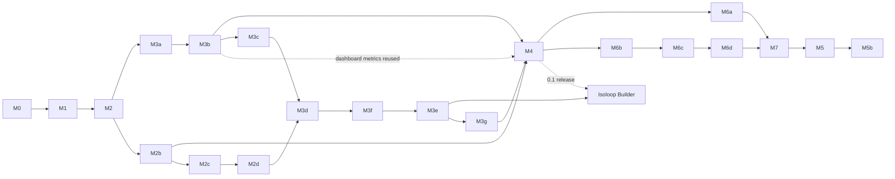

# Implementation plans

One plan per milestone of [RFC 0001](../rfcs/0001-threaded-runtime.md#mvp-roadmap-and-repo-structure), built on the [system design](../design/system-design.md).

| Milestone | Plan | Detail | Status | Done when |
| --- | --- | --- | --- | --- |
| M0 Foundations | [m0-foundations.md](m0-foundations.md) | Full | Done | The four-loops demo runs from the repo and CI is green |
| M1 Kernel | [m1-kernel.md](m1-kernel.md) | Full | Done | A blocked or crashed isolate never affects the others, proven by Playwright tests |
| M2 Bus | [m2-bus.md](m2-bus.md) | Full | Done | A restarted isolate rebuilds its state from the log in a test |
| M2b Durable log | [m2b-durable-log.md](m2b-durable-log.md) | Full | Done | A persistent topic loses no acknowledged record across a bus crash or a page reload |
| M2c Worker pools (headless) | [m2c-worker-pools.md](m2c-worker-pools.md) | Full | Done (2026-11-09) | Pooled and own-worker isolates run side by side; a pool crash restarts only that pool |
| M2d Visual pools | [m2d-visual-pools.md](m2d-visual-pools.md) | Full | Done (2026-11-14, with `plant-v0.1.0`) | The plant dashboard ships with 72 widgets in 9 visual pools |
| M3 Adapters + dashboard (initiative) | [m3-adapters-dashboard.md](m3-adapters-dashboard.md) | Overview | Done (2026-11-15, with `markets-v0.3.0`): M3a–M3d and M3f | Dashboard live on a public URL; recorded comparison in the README |
| ↳ M3a Adapters (epic) | [m3a-adapters.md](m3a-adapters.md) | Full | Done | Both adapters pass the adapter conformance suite on every supported major |
| ↳ M3b Dashboard (epic) | [m3b-dashboard.md](m3b-dashboard.md) | Full | Done (live since `markets-v0.1.0`) | The M3 done-when |
| ↳ M3c Dashboard sizes (epic) | [m3c-dashboard-sizes.md](m3c-dashboard-sizes.md) | Full | Done (`markets-v0.2.0`) | Lite, Normal and Heavy sizes on every build; the comparison across sizes recorded, whatever it shows |
| ↳ M3d Plant dashboard (epic) | [m3d-plant-dashboard.md](m3d-plant-dashboard.md) | Full | Done (`plant-v0.1.0`, 2026-11-14) | 72-widget plant dashboard on three builds and six placements: what the whole package costs against matched native builds, and what it gives |
| ↳ M3f Markets parity (epic) | [m3f-markets-parity.md](m3f-markets-parity.md) | Full | Done (`markets-v0.3.0`, 2026-11-15) | Markets runs a native + workers build and `own`, `one` and `matched` placements, measured in matched pairs on the bench server and written up; ships as `markets-v0.3.0`, after which the website shows markets figures again |
| M3e Live widget creator (epic) | (outline; grill before planning, with the Isoloop Builder as its main client) | — | Not started; moved out of the M3 initiative on 2026-11-15, still before M4 | Users compose a widget from a JSON spec (source → fixed operators: filter/window/aggregate/combine → view) and add it at runtime; sources are a topic, a CSV or JSON upload, or a JSON URL polled at an interval, each upload or URL run as its own headless isolate; the pipeline runs in a new isolate placed in its own worker or a chosen pool; specs persist in a persistent topic; no user code/eval; measured: creator responsiveness while an expensive custom view computes, on native, native + workers and Isoloop |
| M3g Federated comparison (epic) | (outline; grill before planning) | — | Not started; added 2026-11-16, after M3e and before M4 | A native counterpart to the markets dashboard's React + Preact build (`mixed`), the way teams ship parts from several teams today: the Preact part built and shipped apart and loaded at run time by dynamic `import()` from its own manifest (no Module Federation plugin), with the data in hand-written workers; measured head to head against Isoloop `mixed` in `matched` with the M3f method (memory and start-up with two framework runtimes, and what one team's blocked or crashed widget takes down); a write-up, so the site's "parts from many teams" use has figures |
| Website (in `isoloop/web`) | [site.md](https://github.com/isoloop/web/blob/main/docs/plans/site.md) | Full | Done (`site-v0.1.0`, 2026-11-14) | `isoloop.dev` serves the landing page, how it works and the examples hub, with basic embedded live (`site-v0.1.0`); decisions in `isoloop/web` [ADRs 0001–0003](https://github.com/isoloop/web/tree/main/docs/adr) |
| M4 Devtools + 0.1 | [m4-devtools-release.md](m4-devtools-release.md) | Outline | Not started | `0.1.0` on npm with a launch post; the devtools panel runs as an isolate, with the dev MCP last and droppable |
| Isoloop Builder (in `isoloop/builder`) | [builder.md](builder.md) (decisions so far; the plan lives in its own repo, created once M3e is planned) | — | Not started; starts when M3e ships, on `next` prereleases, alongside M4; its first release waits for `0.1.0` | A non-technical user brings data and asks an agent for a dashboard: the agent writes M3e specs only (no code), the user previews and accepts each change set. An E2E test with recorded agent responses goes from an empty app and a CSV to a three-widget dashboard, and one real run by a non-technical person is recorded and written up |
| M6 Vue, Svelte and Solid adapters (initiative) | [m6-adapters.md](m6-adapters.md) | Outline | Not started; after 0.1 | Vue `^3`, Svelte `^5` and Solid `^1` adapters pass the adapter conformance suite on their major, each with a DOM usage log, a smoke test and an example; `isoloop-dom@1` unchanged |
| ↳ M6a Vue (epic) | [m6-adapters.md](m6-adapters.md#epics) | Outline | Not started | A spike picks `createRenderer` or the DOM subset; the adapter passes on Vue 3 |
| ↳ M6b DOM group 2 (epic) | [m6-adapters.md](m6-adapters.md#epics) | Outline | Not started | Our own HTML fragment parser and `cloneNode`/`importNode` in the worker, as ordinary records |
| ↳ M6c Svelte (epic) | [m6-adapters.md](m6-adapters.md#epics) | Outline | Not started | The adapter passes on Svelte 5 |
| ↳ M6d Solid (epic) | [m6-adapters.md](m6-adapters.md#epics) | Outline | Not started | The adapter passes on Solid 1 |
| M7 WebMCP (spike) | [m7-webmcp-spike.md](m7-webmcp-spike.md) | Outline | Not started; after M6 | Findings written up with a yes or a no; an ADR accepted if yes |
| M5 Shared-memory engine | [m5-shared-memory-engine.md](m5-shared-memory-engine.md) | Outline | Not started | Benchmark results published, whichever engine wins |
| M5b Delivery batching (spike) | [m5b-delivery-batching.md](m5b-delivery-batching.md) | Outline | Not started | Findings written up; ADR amending §6.3 or a recalibrated §9 budget accepted |

An outline gets its full task list when it's next to start, so the list reflects what was learned. M3d (the plant dashboard) shipped as `plant-v0.1.0` on 2026-11-14, which also completed M2d. The website launched as `site-v0.1.0` the same day; it lives in `isoloop/web` and is planned there. M3f (markets parity) shipped as `markets-v0.3.0` on 2026-11-15, which completed the M3 initiative: the markets dashboard now runs native, native + workers and pooled placements, measured in matched pairs. M3e (the live widget creator) moved out of M3 that day and is a standalone epic. M3g (a federated native build against Isoloop's React + Preact build) was added on 2026-11-16, after M3e. Next: M3e, then M3g, then M4 (0.1). Decided 2026-11-08: pools come before 0.1 so the plant dashboard can use them. Decided in a grilling on 2026-11-16: M4's devtools are a panel drawn by an isolate, with a dev MCP as its last, droppable item; the Isoloop Builder, an agent that builds dashboards from M3e specs for non-technical users, is planned in its own repo and starts once M3e ships; after 0.1 the order is M6 (Vue, Svelte and Solid adapters), M7 (WebMCP spike), then M5 and M5b. Existing milestone ids stay, so M6 and M7 come before M5 in the graph.

M1 and M2 overlapped: `packages/bus` is pure TypeScript with no browser dependency, so M2 tasks 1–6 ran in parallel with M1.

## Conventions

- **Initiatives and epics:** a large milestone can be an *initiative* that groups *epics* under one goal (M3: M3a and M3b). The initiative's plan holds the goal, the overall done-when and the risks shared by its epics; each epic has its own plan, done-when, demo and write-up.
- **Task size:** about one evening (2–3 h). If a task grows past two evenings, split it.
- **Every task names its files and its tests.** A task is done when its tests pass in CI.
- **Each milestone (or epic) ends with a demo and a write-up** (a short post or README section). That's the RFC's rule: each milestone ends in something that can be demoed, released and written about.
- **Branches:** `<type>/<slug>`, squash-merged to `main`. Types: `feature/` (new behaviour), `fix/` (a bug), `chore/` (tooling, deps, CI, refactors with no behaviour change), `docs/` (docs only). Milestone tasks put the milestone first in the slug, e.g. `feature/m0-workspace-skeleton`. The squash commit uses the matching conventional prefix (`feat:`, `fix:`, `chore:`, `docs:`). Changesets record user-facing changes from M1 on.
- **Merging:** every change, docs included, reaches `main` through a PR that is squash-merged on GitHub (`gh pr merge --squash`). A ruleset on `main` enforces this: PR required, squash only, linear history, no force-push or deletion. The PR title becomes the squash commit title, so it carries the conventional prefix. From M0 task 9 on, CI must be green before merging.
- **Decisions** made during a milestone become ADRs in [`docs/adr`](../adr/README.md).
- **Deferred ideas** live in [`docs/would-like.md`](../would-like.md), not in a plan, until a milestone takes them on.
- **Committed work that waits on something** (a package, a milestone) lives in [`docs/should-do.md`](../should-do.md), with what it waits on and its target milestone. It moves into a plan when that lands.
