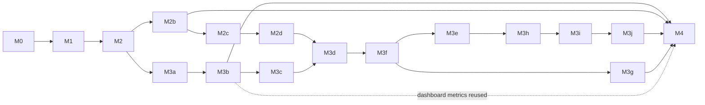

# History

What was decided and shipped, by date, newest first. The order ahead is in the [roadmap](roadmap.md), and each milestone's status in the [plans index](README.md#milestones). Until 2026-11-25 this was one paragraph in the plans index; it was split into dates with its wording kept.

## 2026-11-27

- A rules registry was grilled (Q1–Q31, yes to all) and written up as [ADR 0026](../adr/0026-rules-registry.md) (Proposed): what holds today, one fact per rule, in `docs/rules/`, with each rule's history of decisions and amendments, checked in CI and shown on a local board. It's internal tooling, not a milestone, and runs beside M8 Watchers W1.

## 2026-11-26

- The remaining `0.2` issues were grilled (Q1–Q19, yes to all):
  - #346: a `measuring` state and a `measured` move reason for isolates in quarantine only to be measured, bisect moves included; `quarantined` and `steady` stay for offenders.
  - #409: `supervisor.healthyAfterMs` (default 60 000) is the healthy run that clears the count of short runs, and `withinMs` is the restart window only; ADRs 0001 and 0007 are amended before the code.
  - #410: the React and Preact adapters share one bus subscription per topic across every `useTopic`; the first caller's `from` wins, with a dev warning; M8 Watchers W1's `useWatch` reuses the module.
  - #411: `ctx.bus.publish` and `kernel.publish` become `(topic, value, { key? })`, like `request`, `reply` and `usePublish`, as a hard break in `0.2` with an `isoloop migrate` codemod; the codemod tooling and the `breaking:` changeset check land first ([ADR 0019](../adr/0019-versioning-and-releases.md), decision 10).
  - #389: detectors that tell a starved page from a hung worker are measured first, then the design is grilled and goes into an ADR; nothing from #384 is reused, and its regression becomes a test.
- M9 Module Federation example was grilled (Q1–Q25, then Q26–Q31 on the gaps they left: a read switch for measuring, a strict CSP, where the spike lives and who runs it, the look, the announcement; [its decisions](m9-module-federation.md#decisions-2026-11-26-grilled-maintainer)). It becomes a shop, `apps/shop` in `isoloop/web`: a host and three remotes from three teams (a React product page, a Preact cart, React recommendations built with Rsbuild), each switchable between Module Federation on the main thread and an isolate. It's also the showcase for M8 Watchers, so it now waits for W1. Isolate mode loads remotes through the app's own bootstrap first, then through a `resolveRemote` hook in core and a new `@isoloop/federation` package, whose ADR follows the spike. Only what's new against M3g is measured. The spike starts now on `0.1.x`.
- From the same grilling: an amendment to [ADR 0023](../adr/0023-watchers.md) adds `kernel.watch` to W1, with the shop's header badge as its use case (accepted the same day, #464).

## 2026-11-25

- The plans index was split in three: the [roadmap](roadmap.md) (releases, the order and what 1.0 and 2.0 need), the [plans index](README.md) (the milestones and conventions) and this history. Finished milestones' rows were cut to their date and tag, and their detail moved here.
- M8 Watchers W0 was grilled (Q1–Q30, yes to all) and [ADR 0023](../adr/0023-watchers.md) accepted; W1 is next.
- Added from a design chat with the maintainer: two outlines, each grilled with its ADR before it gets a task list. M15 Derived topics: topics defined by a plan over other topics (filter, map, window, groupBy, aggregate), each kept by a derive isolate, a headless isolate the kernel owns, so a heavy derivation never runs in the bus worker; a TypeScript engine first, then a Rust/WASM engine on M5's toolchain that ships only if it does better on M13. M16 Native runtimes: runtime as part of placement (`worker`, `wasm`, `native`) in a Tauri app, derive isolates first, on M11's decisions, M12's shell and M5's engine built natively. Neither is in [Releases](roadmap.md#releases) yet: M15's slot is open, and M16 runs isolates outside the browser, which the 2026-11-18 rule leaves to `2.0`, so whether it ships in `1.x` is the first question in its ADR. The suggested order (M15 with the TypeScript engine, then M5 and M12 in `0.4.0`, then M16) is not a release decision.

## 2026-11-24

- Decided in a grilling: the order in [Releases](roadmap.md#releases), which replaces the 2026-11-16 order (M6, M7, then M5 and M5b).
- Seven milestones were added as outlines, each grilled before its task list: M8 (watchers, current-value reads beside streams), M9 (a Module Federation example, which answers the question M3g left open by using the plugin itself), M10 (bus pacing, from a 2026-11-20 bus exploration), M11 (a pure kernel core), M12 (Tauri), and M13 and M14, which give ids to the two notes that were in the plans index (the benchmark gate and the big-file split).

## 2026-11-23

- `0.1.0` shipped, which completed M4. On the way: the docs live with the API reference on `0.1.0-next.10`, the source layout in `0.1.0-next.11`, and the staged release pipeline rehearsed in `0.1.0-next.12`.
- M4d: the staged pipeline (`release.yml`), rehearsed in `0.1.0-next.12`, became the only way to publish, then `0.1.0` went on npm with provenance.
- M4c: the write-up (task 27), [the post](../posts/m4c-docs.md); the skill link (task 26) done (web#285).

## 2026-11-22

- M4a done on `0.1.0-next.12`. Task 14, the real-agent run with the write-up, done. Task 12, the skill, done (isoloop#374), and published in `0.1.0-next.12`, so `npx isoloop skill add` installs it from npm.

## 2026-11-21

- Decided in a grilling: M4e joins M4 before `0.1.0`. It lays out each package's `src/` under ADR 0021, adds the checks that keep it that way, and adds a bundle-size guide. It was built the same day and shipped as `0.1.0-next.11`.
- M4e: grilled (Q1–Q31, yes to all), ADR 0021 accepted (#347), tasks 1–17 built the same day (#349–#366, web#240), with 3b and 5b added. The bundle-size guide went live in `site-v0.7.0`.
- M4c's done-when met (`site-v0.6.0`): `/docs/` live with 14 guides, the API and CLI reference from the published types, `llms.txt` and Markdown copies; the docs pipeline (the `docs` skill, `docs/writing.md`, `docs:check` with the TSDoc check, the steward) in CI. Search (task 25) done the same day.

## 2026-11-20

- M3j ran alongside M4 and shipped as `processor-v0.3.0`: on `0.1.0-next.6`, the File processor lost no file in 26 balancer runs (write-up web#200, published web#201); fixes found by its runs shipped in `0.1.0-next.3` to `next.6`.
- M4d: the API frozen in `0.1.0-next.9`.

## 2026-11-17 to 2026-11-19

- Built on `0.1.0-next.0` to `next.5`: M4a's tool surface, the `isoloop` CLI with its dev MCP, `@isoloop/webmcp` (Chromium, and Firefox since ADR 0018's amendment on 2026-11-19), markets' tools and the cost per call, and all of M4b: the inspection feed (ADR 0020) and the devtools panel, live on plant and markets behind `?devtools=1` (`plant-v0.3.0`, `markets-v0.8.0`).
- M4a: tasks 1–11 and 13 done by 2026-11-19. M4b: tasks 1–11 done by 2026-11-19, ADR 0020 accepted and amended.
- Next: M4c, then M4d's API freeze, M4a's skill and real-agent run, and the release.

## 2026-11-17

- Decided in a grilling: 0.1 gets agent support, so M4 became an initiative of four epics: M4a agents (tools on contracts under ADR 0018, `kernel.request`, the CLI with a dev MCP that is no longer droppable, an `@experimental` `@isoloop/webmcp`, `AGENTS.md` and a skill), M4b devtools, M4c docs (with `llms.txt`) and M4d the release (the API freeze first). M4a was grilled and ADR 0018 accepted.
- M7 is no longer a spike: M4a answers its questions, and it became "WebMCP to stable", in [Towards 1.0](roadmap.md#towards-10), waiting only for WebMCP to ship.
- M3h was built: `@isoloop/balancer` is on `next`, the plant and markets interactive pages place `auto` widgets with it, and the new `apps/processor` example (a Playground and a File processor) is its demo, measured on the bench server against `one` and `own`. plant's interactive page places `auto` widgets since `plant-v0.2.0`, and markets' since `markets-v0.6.0`.
- M3e shipped as `plant-v0.2.0`, after plant was re-measured and written up.
- M3h shipped as `processor-v0.1.0` that day, after its write-up's review (web#133).
- M3i (grilled from M3h's File processor measurement: backlog, packing back and fewer moves, inside the balancer only) was built and measured the same day (web#149); its write-up (web#150) found three gaps in the balancer itself: work after `await` that the busy time misses, no packing back, and files lost in runs where the kernel gave up on processors.
- Next: M3j (grilled from that write-up: a reported busy time, packing and the quarantine fixed, and given-up isolates handled, inside the balancer only), alongside M4a, then the rest of M4 (0.1).

## 2026-11-16

- M3g (a federated native build against Isoloop's React + Preact build) was added, after M3e; when it was grilled the same day it moved to run in parallel with M3e, since it needs nothing M3e builds, and shipped as `markets-v0.5.0` that day.
- M3e was grilled the same day: it became an interactive mode for the two example dashboards, with dashboard topics as its only sources and manual placement, and automatic placement split out as M3h.
- M3h was grilled the same day too: an opt-in, host-side balancer driven by a new per-member `busyMs`, with a quarantine pool for widgets that block; its library half (ADR 0017, `busyMs`, the balancer) can be drafted alongside M3e, merging only after the ADR is accepted.
- Later that day the balancer's demo and measurement moved to a new example, `apps/processor`, since plant's page left it little room.
- Decided in a grilling: M4's devtools are a panel drawn by an isolate, with a dev MCP as its last, droppable item; the Isoloop Builder, an app where a non-technical user asks an agent for a whole page, its sources and topics included, is planned in its own repo, separate from M3e (clarified the same day); after 0.1 the order is M6 (Vue, Svelte and Solid adapters), M7 (WebMCP spike), then M5 and M5b. Existing milestone ids stay, so M6 comes before M5 in the graph.

## 2026-11-15

- M3f (markets parity) shipped as `markets-v0.3.0`, which completed the M3 initiative: the markets dashboard now runs native, native + workers and pooled placements, measured in matched pairs.
- M3e (the live widget creator) moved out of M3 that day and is a standalone epic.

## 2026-11-14

- M3d (the plant dashboard) shipped as `plant-v0.1.0`, which also completed M2d.
- The website launched as `site-v0.1.0` the same day; it lives in `isoloop/web` and is planned there.

## 2026-11-08

- Decided: pools come before 0.1 so the plant dashboard can use them.

## Up to 0.1.0

The milestones that led to `0.1.0`, as the plans index drew them until 2026-11-25:

M1 and M2 overlapped: `packages/bus` is pure TypeScript with no browser dependency, so M2 tasks 1–6 ran in parallel with M1.
