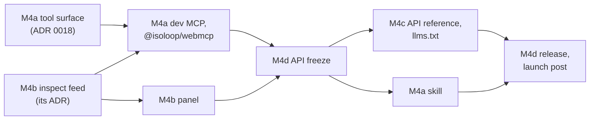

# M4: Devtools, agents and the 0.1 release (initiative)

**Goal:** the first npm release, with what a developer needs around the library on day one: a devtools panel that runs as an isolate, a way for agents to learn Isoloop and to see and call into a running app, and a docs site.

**Done when** (RFC 0001): `0.1.0` is published with a launch post, and each epic below has met its own done-when.

Comes after [M3e](m3e-live-widget-creator.md), [M3h](m3h-auto-placement.md), [M3i](m3i-balancer-scaling.md) and [M3g](m3g-federated-comparison.md) ([M3](m3-adapters-dashboard.md) and [M2b](m2b-durable-log.md) are done). 0.1 also waits for two bus and kernel fixes decided on 2026-11-17: the consumer-group commit loss ([#211](https://github.com/isoloop/isoloop/issues/211), [ADR 0016](../adr/0016-fewer-messages-per-record.md)'s amendment) and the stop-then-spawn race on one isolate id. The `0.0.0-next` prerelease workflow from [M3b](m3b-dashboard.md) task 1 is replaced by the Changesets pipeline in M4d.

**Changed 2026-11-17:** M4 became an initiative of four epics, in a grilling that also brought agent support into 0.1 ([investigation](../investigations/ai-enablers.md)). Until then M4 was one outline with the dev MCP as its last, droppable item, and [M7](m7-webmcp-stable.md) was a WebMCP spike after M6.

## Epics

| Epic | Plan | What | Done when |
| --- | --- | --- | --- |
| M4a Agents | [m4a-agents.md](m4a-agents.md) | Tools on contracts (ADR 0018), `kernel.request`, the `isoloop` CLI, the dev MCP, `@isoloop/webmcp`, `AGENTS.md`, the "build with Isoloop" skill | Agents can learn Isoloop from isoloop.dev and the skill, and can list and call the markets tools through the dev MCP and through WebMCP, with block, crash and `failed` behaving as decided; the cost per call is measured |
| M4b Devtools | [m4b-devtools.md](m4b-devtools.md) | `kernel.inspect()` and the `inspect` grant (their own ADR), then the panel drawn by an isolate | The panel shows isolates, the bus and a live log on plant and markets, and keeps working while the bus restarts |
| M4c Docs | [m4c-docs.md](m4c-docs.md) | The docs site in `isoloop/web`, the guides, the API reference, `llms.txt` | The docs are live on isoloop.dev with `llms.txt`, `llms-full.txt` and a Markdown copy of each page |
| M4d 0.1 release | [m4d-release.md](m4d-release.md) | API review and freeze, changesets, the release pipeline, the launch post | `0.1.0` on npm with provenance, and the launch post is out |

## Order

- M4a's tool surface and M4b's inspection feed run in parallel. The dev MCP's inspection reads wait for M4b's feed.
- The API freeze (M4d task 1) comes once M4a and M4b's public API is merged, and before M4c's API reference and before M4a's skill is finished.
- M4c's guides that don't depend on frozen names (hosting, "What Isoloop can't hide") can start any time.

## Droppable if 0.1 slips

In this order: topic replay (M4b), then `@isoloop/webmcp` (M4a), then the skill (M4a). Firm: `llms.txt`, `AGENTS.md`, tools on contracts with `kernel.request`, the dev MCP, the panel's isolates and bus views and its live log.

## Open risks

- Scope creep in devtools; ship the two panels and the log first.
- Docs time is easy to underestimate; start the "limits" page early.
- WebMCP is still a Community Group draft behind a flag in Chrome; `@isoloop/webmcp` is `@experimental` and in its own package so a change there doesn't touch the other packages.
