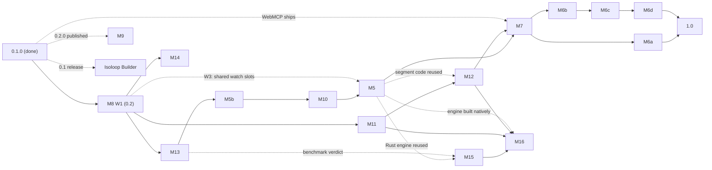

# Roadmap

What comes after `0.1.0`, in order, for the maintainer and the agents working on Isoloop. Each milestone's status is in the [plans index](README.md#milestones); what was decided and when is in the [history](history.md).

Last changed 2026-11-26, in [history](history.md#2026-11-26).

## Releases

The order from `0.1` to `2.0`, decided in a grilling on 2026-11-24. No dates: a minor ships when its milestones meet their done-when. Each milestone that adds to the isolate seam ships in a minor ([ADR 0019](../adr/0019-versioning-and-releases.md)); `0.1.x` carries fixes only, from `release/0.1` ([0.1.1](0.1.1-patch.md) first).

| Version | Milestones |
| --- | --- |
| `0.2.0` | [M8 Watchers](m8-watchers.md) W1, after its ADR; the issues labelled `0.2` (#409 to #414, #389, #346), with #411's break shipping with a codemod. [M9 Module Federation example](m9-module-federation.md) ships as an app tag on `0.2.0` and doesn't hold it |
| No version change, after `0.2.0` | [M13 Benchmark gate](m13-benchmark-gate.md), which blocks `0.3.0`; [M14 Big-file split](m14-big-file-split.md) and [M11 Pure kernel core](m11-pure-kernel-core.md) in parallel, M11 done before M12 |
| `0.3.0` | [M5b Delivery batching](m5b-delivery-batching.md) (spike), then [M10 Bus pacing](m10-bus-pacing.md); [M8 Watchers](m8-watchers.md) W2 |
| `0.4.0` | [M5 Shared-memory engine](m5-shared-memory-engine.md); [M8 Watchers](m8-watchers.md) W3, whichever engine wins; [M12 Tauri](m12-tauri.md) |
| `0.5.0` | [M7 WebMCP to stable](m7-webmcp-stable.md), if WebMCP has shipped; otherwise M6a Vue takes this slot and the adapter minors move up one |
| `0.6.0` | [M6a Vue and M6b DOM group 2](m6-adapters.md) |
| `0.7.0` | [M6c Svelte](m6-adapters.md) |
| `0.8.0` | [M6d Solid](m6-adapters.md) |
| `1.0.0` | Previews start once the [1.0 done-when](#towards-10) is met |
| `2.0.0` | [Node, Bun and server-side rendering](#towards-20-node-bun-and-server-side-rendering) |
| Floating | The agent port skill, the model-isolate example and the Claude Code plugin ([Towards 1.0](#towards-10)), and the [Isoloop Builder](builder.md). None holds a library release |

## Order

## Towards 1.0

The [releases](#releases) lead here. 1.0 previews start when the maintainer adds the `release-1.0` label ([ADR 0019](../adr/0019-versioning-and-releases.md), decision 7), once the done-when below is met.

### The 1.0 done-when

- Every API still marked `@experimental` has a recorded decision: it leaves `@experimental` in its ADR, or it stays experimental through 1.0 and the docs page that lists them says so (ADR 0019, decision 4). `@isoloop/webmcp` may stay experimental while WebMCP hasn't shipped, so 1.0 never waits on browser vendors.
- The isolate seam's `FLOOR` for 1.0 is set, so semver's majors take over from the `major.minor` check ([ADR 0012](../adr/0012-isolates-built-apart.md), decision 4).
- The support policy is decided again for 1.x, as ADR 0019's decision 9 asks, including whether a previous minor gets fixes.
- [M13 Benchmark gate](m13-benchmark-gate.md) runs in CI, so performance figures compare from one 1.x release to the next.
- The [M6 Vue, Svelte and Solid adapters](m6-adapters.md) have shipped.
- Not required for 1.0: M5's engine winning (it ships only if it wins), M7, the Builder, and versioned docs, which [would-like](../would-like.md#docs) leaves until a 1.x line has users on more than one minor.

### Agent work, floating

From the 2026-11-17 grilling ([investigation](../investigations/ai-enablers.md)). None of these holds a library release or is part of the 1.0 done-when. Each gets a milestone id when it starts.

- **[M7 WebMCP to stable](m7-webmcp-stable.md):** drop `@experimental` once WebMCP ships, using `toolchange`, perhaps with a shim. Slotted for `0.5.0` in [Releases](#releases).
- **An agent skill that ports an existing app to Isoloop,** with an eval set of 3–5 apps run in CI (the 0.1 skill is tested by hand). React and Preact apps can be ported today, so it doesn't wait for M6; each new adapter adds to its eval set when it ships.
- **A Claude Code plugin** bundling the skills and the dev MCP.
- **A model-isolate example:** Transformers.js or WebLLM in an own-worker headless isolate that serves a request contract, showing what a model hang or crash does to the page.
- **The Isoloop Builder as a third tool user** (`via: 'builder'`), plus its Claude Desktop bridge on the dev MCP's transport code ([builder.md](builder.md)).
- **Re-check later:** MCP Apps (needs a server, outside the tab boundary) and Chrome's Prompt API (not available in workers as of 2026-11-17).

## Towards 2.0: Node, Bun and server-side rendering

Decided by the maintainer on 2026-11-18, with no ADR yet: **1.x stays browser-only, and Node, Bun and server-side rendering are 2.0 scope.** Server-side rendering stays the non-goal [RFC 0001](../rfcs/0001-threaded-runtime.md#problem-goals-and-non-goals) gives for v1. It's a note, not planned; it gets an ADR and a plan when 2.0 is grilled.

- **What ports:** headless isolates, the bus worker, the supervisor's heartbeats and restarts, replay and grants map onto `worker_threads` in Node, and Bun has the same API. A Node host also gets what a browser doesn't give: a hard heap cap per worker (`resourceLimits`), `SharedArrayBuffer` without COOP and COEP, and memory per worker.
- **What doesn't port as it is:** surfaces and the host side of the render bridge, the durable log on OPFS (a file `LogStorage` instead), loading isolate code by `https` URL, and the routing topic.
- **The shell:** a Node or Bun host is another shell around [M11 Pure kernel core](m11-pure-kernel-core.md)'s decisions.
- **Server-side rendering:** a Node host serializes each isolate's `isoloop-dom` tree to HTML, and bus replay does the hydration: the page embeds the compacted topics, and the client's isolates replay them. The hard parts are matching node ids between server and client, buffering input before the client's workers start, warm workers that reset between requests without leaking state, and placeholders for canvases.
- **Costs and competition:** a worker per isolate costs memory on a server too, and Piscina and Tinypool already pool plain workers, so the case for Isoloop on a server is the bus, supervision and replay, not the pool.
