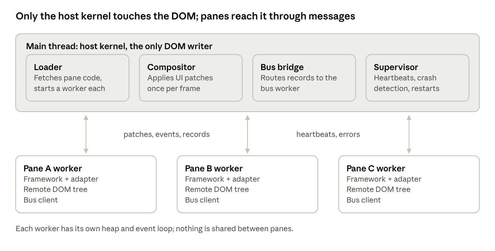
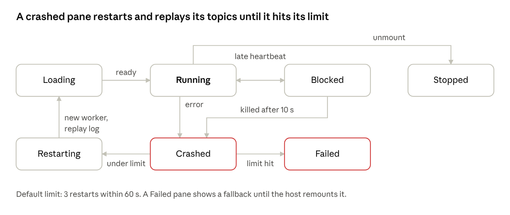

# RFC 0001: A threaded runtime for isolated front-end code

- **Status:** Draft
- **Author:** Sabin Pandelovitch
- **Created:** 2026-10-30
- **Updated:** 2026-11-04

## Summary

Isoloop is an open-source browser runtime that runs every isolate (a UI widget, a micro-frontend, or headless logic such as a state store) in its own Web Worker, so no isolate can freeze, crash or read another. The main thread keeps one job: drawing what visual isolates describe; headless isolates never touch it except for heartbeats. Isolates talk only through a log-based message bus with typed topics and replay, so an isolate that restarts rebuilds its state from the log.

- **Pitch:** code that shares data shouldn't have to share an event loop. Run independent pieces of front-end code (dashboard widgets, plugins, AI-generated widgets, headless engines such as state stores or sync engines) side by side, sharing data through the bus, without letting any one of them break the host.
- **Who it is for:** heavy dashboards first, whose widgets share data but shouldn't share an event loop; also platform teams that host other teams' or vendors' code (trusted but unreliable, not hostile), apps with heavy headless engines, and backend-less apps whose fetching and aggregating pipelines run in the tab and ship to a static host. Scope is the browser tab only.
- **Name:** Isoloop, for an isolated event loop per unit. It was called Federa until 2026-11-03, when the `@federa` npm scope turned out to be taken ([ADR 0004](../adr/0004-npm-name.md)). The unit of isolation is an *isolate*; an isolate that draws UI has a *surface* ([ADR 0008](../adr/0008-isolates-and-surfaces.md)).
- **Where it stands:** a working proof of concept exists (four isolates, bus, heartbeats, restart supervisor).

## Problem, goals and non-goals

Today all the front-end code on a page (micro-frontends, widgets and headless engines alike) shares one main thread, one heap and one event loop. One slow or broken piece makes the whole page janky or blank, and sandboxes built from JS proxies or Shadow DOM isolate globals and styles, not CPU time or crashes.

**Goals**

1. **Thread isolation:** each isolate gets its own worker, so a blocked or crashed isolate affects only itself.
2. **Single-writer rendering:** only the host touches the DOM; isolates send UI descriptions.
3. **Messages as the only contract:** isolates never import each other; they depend on versioned topic schemas.
4. **Durable, replayable bus:** topics are append-only logs with retention and consumer offsets.
5. **Supervision:** liveness heartbeats, crash detection and restart strategies, built in.
6. **Framework-agnostic isolates:** an isolate can be written in React, Preact, Svelte, Solid or plain JS.

**Non-goals for v1**

- Parallel painting of DOM surfaces. The DOM still has one writer; canvas isolates can already paint in parallel through `OffscreenCanvas`, and cross-origin iframes are the later route for DOM.
- Replacing Module Federation for code sharing between trusted teams.
- Angular, or any framework that needs a real DOM at runtime.
- Server-side rendering of isolates.
- A security boundary against hostile code. Workers are same-origin; untrusted code needs the iframe tier (see Risks).

## Architecture overview

Isoloop is a small kernel on the main thread with four parts, a dedicated bus worker, and one dedicated worker per isolate.



- **Loader:** resolves an isolate's manifest, fetches its code (URL or Module Federation remote), and starts it in a module worker with the runtime prepended.
- **Compositor:** owns every surface in the DOM and applies patches in a frame-budgeted batch.
- **Bus bridge:** passes records between isolates and the dedicated bus worker, which holds the topic logs, checks schemas and access rules, and delivers records to subscribers. *Refined by [ADR 0005](../adr/0005-bus-topology-message-channels.md): the bridge only wires a direct `MessageChannel` between each isolate and the bus worker, so records never cross the main thread.*
- **Supervisor:** watches heartbeats, catches errors and applies restart strategies.

The kernel is framework-agnostic and has no dependencies beyond Remote DOM. The host app around it can be written in anything.

## Isolate model and lifecycle

An isolate is a manifest plus a code bundle, with or without a surface; the supervisor moves it through seven states and restarts it on its own after a crash.

```ts
type IsolateManifest = {
  id: string;                       // unique in the host
  src: string;                      // ES module URL or federation remote
  surface?: string | Element;       // where it renders; omit for a headless isolate
  adapter?: 'react' | 'preact' | 'vanilla';
  topics: { publish: string[]; subscribe: string[] };
  restart?: { strategy: 'one-for-one' | 'never'; max: number; withinMs: number };
  resources?: { memoryMb?: number };  // advisory, reported by heartbeats
};
```



A "blocked" isolate is still alive: its loop is busy, so the host shows a subtle busy state and queues its messages. Only an isolate that stays blocked past the kill timeout is terminated and treated as crashed.

## Rendering bridge

Isolates render into an invisible remote tree inside the worker; the host mirrors it to the real DOM. Isoloop builds this on [Shopify Remote DOM](https://github.com/Shopify/remote-dom) rather than writing its own, which saves the hardest maintenance work.

- **Remote tree:** a DOM polyfill in the worker lets ordinary framework code create elements. A mutation observer turns changes into a stream of small patches.
- **Host component registry:** the host decides which elements an isolate may render. Built-in safe HTML tags, plus host components such as `<iso-button>` that map to the design system. Unknown tags render as `div`; `script`, `iframe` and inline handlers are never created.
- **Frame batching:** patches queue per isolate and apply once per animation frame. A frame budget (default 8 ms of DOM work) stops one chatty isolate from starving the others; leftover patches roll to the next frame.
- **Events:** the host listens once per surface, serializes the event (type, target node id, value, key, pointer position) and posts it to the worker. Default actions such as form submit are prevented on the host and handled by the isolate.
- **Inputs:** text fields are host-owned and uncontrolled. The host keeps the caret and value; the isolate gets `input` events and may send a value back, applied only if it differs. This avoids the lag of a full round trip per keystroke.
- **Layout queries:** `measure(nodeId)` and `focus(nodeId)` are async calls to the host, returning a promise in the isolate.
- **Styles:** each surface is a Shadow DOM host, so isolate CSS can't leak out. Isolate styles are sent as text and adopted as constructable stylesheets.
- **Canvas isolates:** an isolate can take an `OffscreenCanvas` transferred from the host and draw charts entirely inside its worker, in parallel with the main thread.

## Message bus

The bus is a small in-browser log, modelled on Kafka: each topic is an append-only log, and each consumer tracks its own position in it. Replay is what makes restarts cheap: a restarted isolate reads its topics from its last committed offset, or from the start, and rebuilds its state.

| Concept | Isoloop meaning | Kafka equivalent |
| --- | --- | --- |
| Topic | Named, typed, append-only log, e.g. `cart.items.v1` | Topic |
| Record | `{offset, key, value, ts, producer}` | Record |
| Retention | Per topic: `last-n`, `time`, or `compacted` (latest record per key) | Retention / log compaction |
| Consumer | An isolate subscription with a committed offset | Consumer + offset |
| Group | Several isolate instances sharing one subscription, each record to one of them | Consumer group |
| Start position | `latest`, `earliest` or `committed` | `auto.offset.reset` |
| Schema | Zod or JSON Schema per topic version, checked on publish | Schema registry |

**Semantics**

- **Ordering:** guaranteed per topic, and per key within a topic.
- **Delivery:** at-least-once to a live isolate. Consumers commit offsets after handling, so handlers must be idempotent.
- **Validation:** the broker rejects a record that fails its topic schema and reports it to the producer. A bad isolate can't poison other isolates' state.
- **Backpressure:** each isolate has an inbox limit (default 1,000 records). When a blocked isolate's inbox is full, the broker stops pushing and the isolate catches up from the log when it's free; nothing is lost while retention allows.
- **Request/response:** a thin layer on top: a `requests` topic plus a reply sent to the caller with a correlation id and a timeout.
- **Persistence:** topics marked `durability: 'persistent'` are written to the Origin Private File System, so they survive a bus worker crash and a page reload ([ADR 0007](../adr/0007-bus-worker-supervision.md), milestone M2b, before 0.1).
- **Access control:** the isolate manifest declares which topics it may publish and subscribe to; the broker enforces it.

**Placement and engines.** The broker runs in a dedicated bus worker from v1, so the main thread only draws. Log storage sits behind a pluggable engine interface (`append`, `read(fromOffset)`, `commit`, `compact`). v1 ships a plain TypeScript engine. A later Rust/WASM engine keeps the log in a `SharedArrayBuffer` ring buffer, so isolates read records straight from shared memory with no copy per subscriber. That engine needs a cross-origin-isolated host (COOP/COEP headers), so it stays opt-in and ships only if published benchmarks show it beating the TS engine.

## Wire protocol

Every message between host and isolate uses one envelope, versioned from day one so hosts and isolates can be deployed separately.

```ts
type Envelope<T extends string, P> = {
  v: 1;            // protocol version
  t: T;            // message type
  id?: string;     // set when a reply is expected
  re?: string;     // id of the message this replies to
  p: P;            // payload
};
```

| Type | Direction | Payload | Purpose |
| --- | --- | --- | --- |
| `init` | host → isolate | isolate id, config, granted topics | Boot the isolate |
| `ready` | isolate → host | runtime version, adapter | Isolate is up |
| `patch` | isolate → host | Remote DOM mutations | Update the UI |
| `event` | host → isolate | node id, event type, serialized event | User input |
| `call` / `result` | both ways | method, args / value or error | Async host APIs (`measure`, `focus`, `navigate`) |
| `publish` | isolate → host | topic, key, value | Append to a topic |
| `subscribe` / `unsubscribe` | isolate → host | topic, start position | Manage a subscription |
| `deliver` | host → isolate | topic, records[] | Batch of records |
| `commit` | isolate → host | topic, offset | Acknowledge records |
| `beat` | isolate → host | loop lag in ms, heap size if available | Liveness |
| `error` | isolate → host | message, stack | Reported failure |
| `shutdown` | host → isolate | reason, grace period | Clean stop before terminate |

Payloads are copied with structured clone. Large binary data travels as `ArrayBuffer` transferables, never copied.

## Public API sketch

The host API is a few lines and works without any framework. The isolate API feels like normal framework code; the adapter hides the worker.

**Host**

```ts
// @acme/contracts: shared by host, isolates and the bus worker
import { contracts, topic } from '@isoloop/bus';
import { z } from 'zod';

export const cartItems = topic('cart.items.v1', {
  schema: z.object({ sku: z.string(), qty: z.number().int() }),
  retention: { kind: 'compacted' },
});
export default contracts(cartItems);
```

```ts
// host
import { createKernel } from '@isoloop/host';
import list from '@acme/contracts';

const kernel = createKernel({
  contracts: { url: '/contracts.js', list },   // the bus worker imports the same module from url (ADR 0003)
  components: { 'iso-button': DsButton },   // host component registry
  supervisor: { strategy: 'one-for-one', maxRestarts: 3, withinMs: 60_000 },
  heartbeat: { everyMs: 100, blockedAfterMs: 400, killAfterMs: 10_000 },
});

kernel.spawn({
  id: 'cart',
  surface: '#cart',          // omit for a headless isolate
  src: 'https://cdn.example.com/cart/isolate.js',
  topics: { publish: ['cart.items.v1'], subscribe: ['catalog.selected.v1'] },
});

kernel.on('isolate:crash', ({ id, error }) => report(id, error));
```

**Isolate (React adapter)**

```tsx
import { defineIsolate, useTopic, usePublish } from '@isoloop/react';
import { cartItems } from '@acme/contracts';

export default defineIsolate(() => {
  const items = useTopic(cartItems, { from: 'earliest' }); // replayed after restart
  const add = usePublish(cartItems);
  return (
    <iso-button onClick={() => add({ key: 'sku-1', value: { sku: 'sku-1', qty: 1 } })}>
      Add ({items.length})
    </iso-button>
  );
});
```

Topic definitions live in a shared contracts package, the only code host, isolates and the bus worker share. It holds types, schemas and pure seed maps, never I/O or application behaviour ([ADR 0003](../adr/0003-schema-format-standard-schema.md)).

## Framework adapters

An adapter is a thin package that boots a framework inside the worker's DOM polyfill and exposes bus hooks in that framework's style. The kernel itself knows nothing about frameworks.

| Framework | Fit | Notes |
| --- | --- | --- |
| Plain JS / Web Components | Good | Reference adapter; smallest |
| Preact | Good | Small runtime, works on Remote DOM today; best first adapter |
| React | Good, heavier | Needs Remote DOM's React polyfill; bigger bundle per isolate |
| Solid | Likely good | Fine-grained updates map well to small patches; to verify |
| Svelte | Likely good | Compiled output uses plain DOM calls; to verify |
| Vue | Uncertain | Runtime DOM renderer probably works; custom renderer possible |
| Angular | Poor | Assumes a real DOM and browser globals in many places; out of scope for v1 |

**What no adapter can hide**

- Synchronous layout reads (`getBoundingClientRect`, `offsetWidth`), synchronous focus and scroll.
- Third-party widgets that reach for `window`, `document.body` or `localStorage`.
- Drag and drop, text selection and canvas drawing tied to pointer timing. Canvas isolates can use `OffscreenCanvas` instead.

The docs should state these limits up front; they are what will decide whether people trust the project.

## Prior art

No existing project combines a thread per isolate, a supervisor and a replayable bus; each of the closest ones covers one part.

| Project | What it does | Thread per isolate | Supervision | Replayable bus |
| --- | --- | --- | --- | --- |
| [Shopify Remote DOM](https://github.com/Shopify/remote-dom) | Mirrors a DOM tree built in a worker or iframe onto the host page | Possible, not managed | No | No |
| [Neo.mjs](https://github.com/neomjs/neo) | Whole app runs in an App Worker; a VDom Worker diffs; main thread applies deltas | No, one App Worker per app | No | No |
| [Web Fragments](https://github.com/IgorMinar/reframed) | Separate JS contexts per micro-frontend sharing one DOM | No, same thread | No | No |
| [Aiga](https://aiga.js.org/) | Iframe-based micro-frontends with isolation tiers and typed RPC | Process per iframe | Keep-alive, no restarts | No |
| [Garfish](https://github.com/web-infra-dev/garfish), qiankun | Proxy and Shadow DOM sandboxes on the main thread | No | No | No |
| Module Federation | Loads and shares code between builds | No | No | No |

Isoloop uses Remote DOM for rendering and adds the kernel around it. Its pitch against Neo.mjs: isolation between isolates and teams, not just off-main-thread speed.

## Risks and open questions

The biggest risk is input latency: if typing or clicking feels slower than a normal app, people drop the project after the first demo.

| Risk | Impact | Mitigation |
| --- | --- | --- |
| Input latency from the worker round trip | High | Host-owned inputs; a benchmark for click-to-paint in CI |
| Memory: one heap and framework copy per isolate | Medium | lazy start, opt-in suspension of idle isolates (`suspend`), a soft worker budget warning, a shared runtime bundle cached per origin |
| Main thread still a single point of failure | Medium | Frame budget per isolate; document it honestly |
| Same-origin workers are not a security boundary | High for untrusted code | An iframe tier later, with workers inside cross-origin iframes |
| Remote DOM API changes | Medium | Pin versions; keep it behind an internal interface |
| Scope creep: devtools, adapters, persistence | High for a solo maintainer | Strict MVP; adapters beyond Preact and React left to contributors |

**Decided**

- [x] Broker placement: a dedicated bus worker from v1, with a pluggable log engine.
- [x] Monorepo tooling: plain pnpm workspaces.

**Open questions** (each now has a proposed answer in an ADR; see the [system design](../design/system-design.md))

- [x] Workers per isolate, or a pool that can host several trusted isolates per worker? Decided: own worker by default, opt-in named pools after M2 ([ADR 0001](../adr/0001-one-worker-per-isolate.md)).
- [x] How does routing work: does the host own the URL and pass route events to isolates? Yes, via the opt-in `isoloop.route.v1` topic, a granted `navigate` call and `kernel.syncRoute()` ([ADR 0002](../adr/0002-host-owns-routing.md)).
- [x] Which schema format: Zod only, or JSON Schema so non-JS tools can read contracts? Standard Schema at runtime, JSON Schema exported ([ADR 0003](../adr/0003-schema-format-standard-schema.md)).
- [x] Is the name free on npm? `federa` was, but the `@federa` scope is taken, so the project is renamed **Isoloop** ([ADR 0004](../adr/0004-npm-name.md)). Claimed: the `@isoloop` npm scope, the unscoped `isoloop` package and the `isoloop` GitHub org.

## MVP roadmap and repo structure

Eight milestones, each ending in something that can be demoed, released and written about. No dates yet; each is roughly 2 to 4 weeks of evenings. The [plans index](../plans/README.md) is the source of truth for milestone order, dependencies and task lists; this list is kept in sync with it.

1. **M0, foundations:** pnpm workspaces, TypeScript 7, the OXC tools (oxlint, oxfmt, tsdown), Vite 8, Vitest, Playwright and GitHub Actions ([ADR 0009](../adr/0009-toolchain.md)); the wire protocol types; the proof of concept ported to TypeScript. Done when the four-loops demo runs from the repo and CI is green.
2. **M1, kernel:** loader, supervisor with one-for-one restarts, heartbeats, frame-batched compositor on Remote DOM. Done when a blocked or crashed isolate never affects the others, proven by Playwright tests.
3. **M2, bus:** topics with schemas, retention, offsets, replay and backpressure, in a dedicated bus worker behind the engine interface, with the TS engine. Done when a restarted isolate rebuilds its state from the log in a test.
4. **M2b, durable log:** topics with `durability: 'persistent'` written to OPFS, surviving a bus worker crash and a page reload, with flush on `freeze`/`pagehide` ([ADR 0007](../adr/0007-bus-worker-supervision.md)). Depends on M2; must land before the 0.1 release. Done when a persistent topic loses no acknowledged record across a bus crash or a page reload in an E2E test.
5. **M2c, worker pools:** opt-in named pools for headless isolates (`manifest.pool`), supervised as a group, starting with a benchmark gate that can drop pools if they don't pay off ([ADR 0001](../adr/0001-one-worker-per-isolate.md)). Depends on M2; not required for 0.1. Done when pooled and own-worker isolates run side by side and a pool crash restarts only that pool.
6. **M3, adapters and dashboard sandbox:** Preact and React adapters with `useTopic` and `usePublish`, plus `examples/dashboard`, the flagship demo: a backend-less markets dashboard with one headless feed isolate per exchange (public WebSocket feeds, or recorded ticks replayed for reproducible runs), an aggregator, an alerts isolate, 3 `OffscreenCanvas` charts, a virtualized trades table, a shared filter topic and stress controls per widget. A toggle runs the same dashboard single-threaded or on Isoloop, beside a live metrics panel: main-thread fps, long tasks, input latency, loop lag per worker, memory and bus throughput. Done when it's live on a public URL and a recorded comparison is in the README.
7. **M4, devtools and 0.1 release:** an overlay showing each isolate's loop health and a live bus log with replay; docs site; npm publish. Done at `0.1.0` with a launch post.
8. **M5, shared-memory engine:** the opt-in Rust/WASM `SharedArrayBuffer` log engine, benchmarked against the TS engine. Done when the benchmark results are published, whichever engine wins.

**Repo structure** (plain pnpm workspaces; Turborepo can be added later if builds slow down)

```text
isoloop/
  packages/
    protocol/      wire types, envelope, versioning
    host/          kernel: loader, compositor, supervisor
    runtime/       worker runtime, DOM polyfill wiring, bus client
    bus/           broker, log engine interface, TS engine (no DOM, easy to test)
    codec/         (M2b) binary value codec for OPFS records, shared with M5
    bus-wasm/      (M5) Rust/WASM shared-memory log engine
    react/         adapter
    preact/        adapter
    devtools/      overlay panel
  examples/
    four-loops/    the original minimal demo
    dashboard/     markets dashboard sandbox: single-thread vs Isoloop, live metrics
  docs/            site + RFCs
  bench/           click-to-paint, bus throughput, memory per isolate
```

Keep `bus` free of browser APIs so it can be unit-tested in Node and reused in other hosts later.
